# Match Them All: User Guide

This guide shows you how to run the template, build your own levels and items, and set up the shop, sounds,
power-ups, ads and in-app purchases. Every step is done in the Unity Editor. You only need to code for new
power-up behaviour or new reward rules.

<p align="center">
  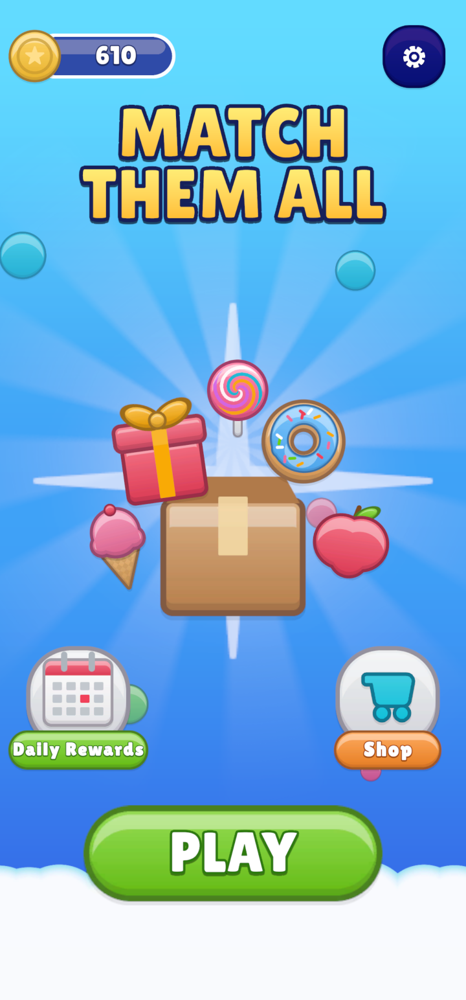
  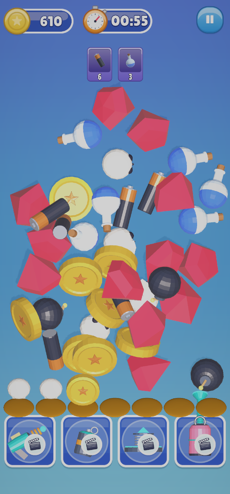
  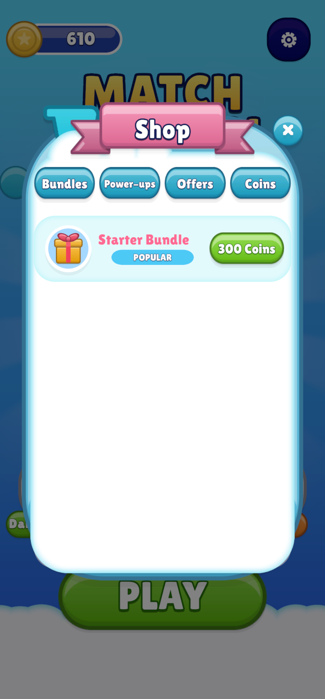
</p>

**Contents**

1. [Install and first run](#1-install-and-first-run)
2. [How the game plays](#2-how-the-game-plays)
3. [Where everything lives](#3-where-everything-lives)
4. [Make a level (Template Editor)](#4-make-a-level-template-editor)
5. [Add an item (Item Manager)](#5-add-an-item-item-manager)
6. [Set up the shop (Shop Manager)](#6-set-up-the-shop-shop-manager)
7. [Change sounds and music (Sound Manager)](#7-change-sounds-and-music-sound-manager)
8. [Power-ups](#8-power-ups)
9. [Daily rewards and global settings](#9-daily-rewards-and-global-settings)
10. [Ads and in-app purchases](#10-ads-and-in-app-purchases)
11. [Build for Android / iOS](#11-build-for-android--ios)
12. [Troubleshooting](#12-troubleshooting)

---

## 1. Install and first run

### Requirements

| What | Version | How to get it |
|---|---|---|
| Unity | **6000.0 LTS** (Unity 6) or newer | Unity Hub |
| Universal Render Pipeline | 17.x | installed with the project |
| Input System | 1.19+ | installed with the project |
| Addressables | 3.1+ | installed with the project |
| PrimeTween | 1.x | free on the Asset Store. Not bundled: import it before the template. |
| ZLinq | latest | *Package Manager ▸ + ▸ Add package from git URL*: `https://github.com/Cysharp/ZLinq.git?path=src/ZLinq.Unity/Assets/ZLinq.Unity` |
| NaughtyAttributes | bundled | `ThirdParty/NaughtyAttributes` (MIT) |
| Ads Mediation (LevelPlay), In-App Purchasing | optional | see [section 10](#10-ads-and-in-app-purchases) |

### First run

1. Open `Assets/MatchThemAllTemplate/Scenes/OpenScene.unity`.
2. Switch the Game view to a phone shape. Either pick a portrait resolution in the Game view's aspect
   drop-down (for example 1440×3088), or open *Window ▸ General ▸ Device Simulator* and choose a phone.
   On a wide Game view the UI looks squashed.
3. Press **Play**. The game starts in the Lobby: tap **Play**, choose a level on the map, and play.

> **Start from OpenScene.** Opening `MainScene` directly works for testing, but the Template Editor's
> **▶ Play Level** button (section 4) is the quickest way to jump into one level.

---

## 2. How the game plays

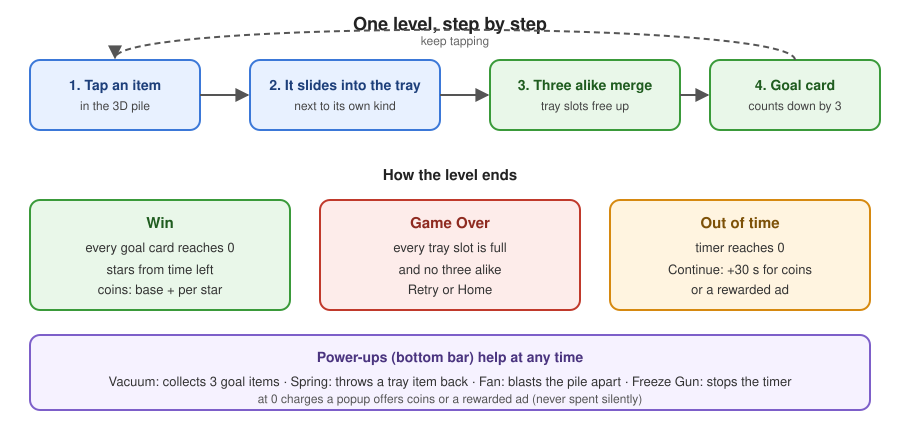

- The board is a 3D pile of items. The **goal cards** at the top show which items to collect and how many.
- Tapping an item sends it to the **tray** at the bottom, next to items of the same kind.
- Three of a kind in the tray **merge** and free their slots. A merge of a goal item counts down its card.
- **Win:** every goal card reaches 0. Stars come from the time left, and coins from the level's reward settings.
- **Game Over:** the tray is full and holds no three of a kind.
- **Out of time:** the player can continue (more seconds) for coins or by watching a rewarded ad.

<p align="center">
  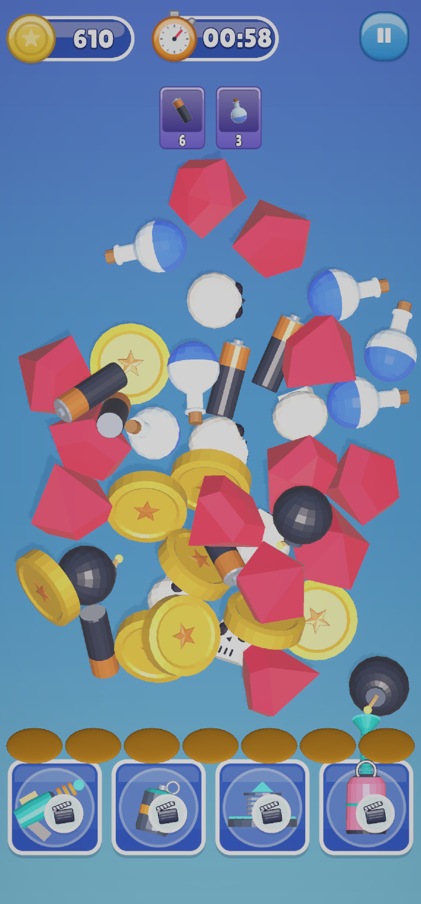
  
</p>

*Left: a level starts with goal cards (top), the timer, the pile, the empty tray and the power-up bar.
Right: after three taps, the two skulls sit together in the tray.*

---

## 3. Where everything lives

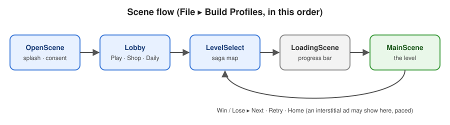

```
Assets/MatchThemAllTemplate/
├── _START_HERE/
│   ├── Levels/        ← one LevelDataNN.asset per level (edit with the Template Editor)
│   └── Items/         ← one Item_*.prefab per item type (edit with the Item Manager)
├── Resources/
│   ├── GameSettings.asset          ← continue cost and time bonus
│   ├── Monetization/               ← MonetizationSettings + ConsentPopup prefab
│   ├── Powerups/                   ← PowerupDatabase + one Powerup_*.asset per power-up
│   ├── Shop/                       ← ShopDatabase, tabs, products
│   └── Sound/SoundLibrary.asset    ← every sound and music clip
├── Scenes/            ← OpenScene, Lobby, LevelSelect, LoadingScene, MainScene
├── Prefabs/  Art/  Audio/  Shaders/  Settings/
├── Scripts/Runtime/   ← game code (MatchThemAll.Scripts…)
├── Scripts/Editor/    ← the four editor tools
└── Documentation/     ← this guide, MONETIZATION_SETUP.md, API_REFERENCE.md
```

The four editor tools are in the **Match Them All** menu at the top of the Unity window:

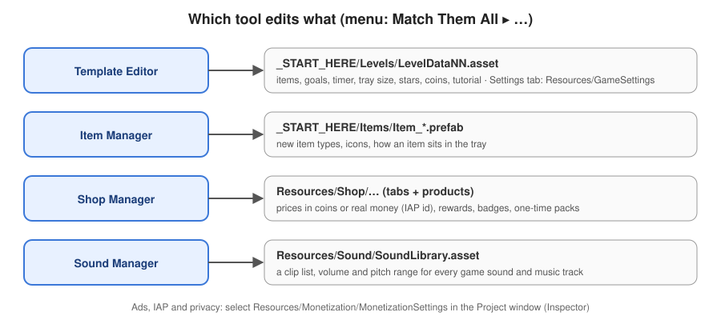

Each tool edits ordinary assets. You can also select those assets in the Project window and change them in
the Inspector. The tools just put everything in one place.

---

## 4. Make a level (Template Editor)

Open **Match Them All ▸ Template Editor**.

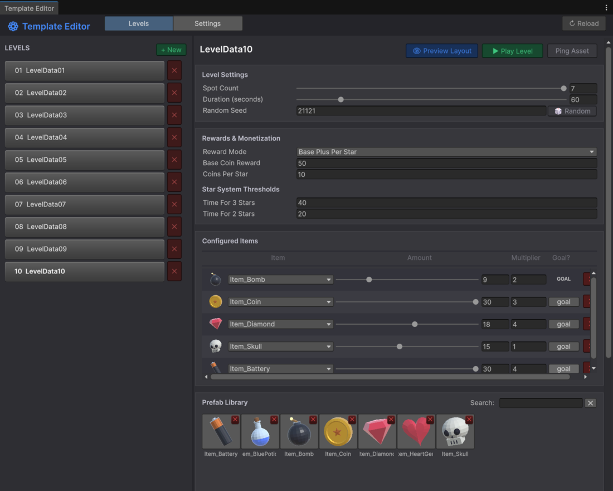

### Create, test, save

1. Click **+ New** (top of the LEVELS list). The new level is saved in `_START_HERE/Levels/` and registered
   with Addressables (label `LevelData`), so the level map picks it up by itself.
2. Fill in the sections described below.
3. Click **👁 Preview Layout** to drop the pile into the Scene view. Change **Random Seed** (or click
   **🎲 Random**) until you like the layout.
4. Click **▶ Play Level** to play only this level.
5. Click **💾 Save** (top bar). **↻ Reload** throws away unsaved changes.

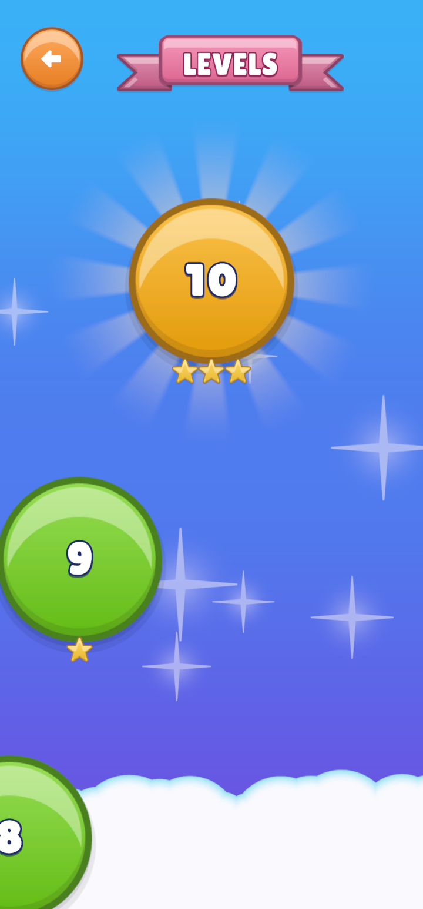

Levels appear on the map in name order (`LevelData01`, `LevelData02`, …). To reorder, rename the assets.
The map shows the stars earned on each level and unlocks the next level after a win.

<br clear="right">

### Level Settings

| Field | What it does |
|---|---|
| **Spot Count** | Tray slots, from 5 to 7. Fewer slots make a harder level. |
| **Duration (seconds)** | The level timer, from 15 to 300. |
| **Random Seed** | Decides where items fall. The same seed always gives the same pile. |

### Rewards & Monetization

| Field | What it does |
|---|---|
| **Reward Mode** | *Fixed Value*: always pays **Base Coin Reward**. *Base Plus Per Star*: base plus **Coins Per Star** × stars. |
| **Time For 3 Stars / 2 Stars** | Seconds that must be **left** on the timer for 3 or 2 stars. Any win gets at least 1 star. |

### Configured Items

Each row is one item type in the pile.

| Column | What it does |
|---|---|
| **Item** | The item prefab (from `_START_HERE/Items`). |
| **Amount** | How many the player must collect (3 to 30). **Must be a multiple of 3**, because items merge in threes. |
| **Multiplier** | Copies on the board = Amount × Multiplier. Use 2 or more to add decoys and make finding them harder. |
| **Goal?** | **GOAL** shows the item as a goal card. **goal** (lower case) means filler: it is in the pile but not required. |

Click a tile in the **Prefab Library** to add that item to the list. The red **✕** on a tile moves the
prefab to the **Trash Bin** below, from where you can restore it. Right-click a tile for *Delete
Permanently…*.

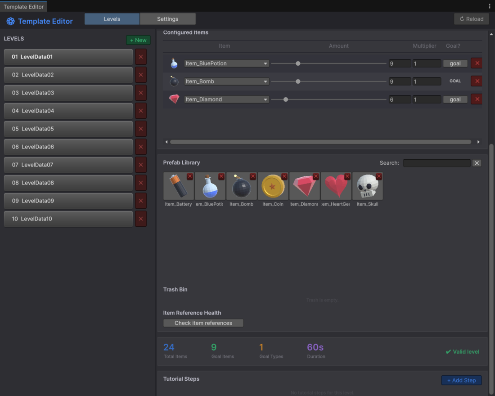

The summary bar shows the total items, goal items and duration. **✔ Valid level** means the level can be
played. **Check item references** finds level rows that point at a deleted prefab.

### Tutorial Steps (optional)

Click **+ Add Step** to put a guided step at the start of the level. Each step has:

| Field | Options |
|---|---|
| **Message** | Text in the tutorial bubble. |
| **Highlight Target** | *Auto Find Items* (any 3 alike), *Specific Item*, *Powerup* (a tray button, by id such as `vacuum`), *Goal Card*, *Manual Targets* (drag in objects). |
| **Completion Condition** | *On Merge*, *On Powerup Used*, *On Timer* (after **Auto Complete Delay**), or *Manual* (call `TutorialManager.Instance.CompleteCurrentStep()`). |
| **Start Delay / Pause Timer** | Waits before showing the step, and stops the clock while it shows. |

### Settings tab

The **Settings** tab edits `Resources/GameSettings.asset`. See [section 9](#9-daily-rewards-and-global-settings).

---

## 5. Add an item (Item Manager)

Open **Match Them All ▸ Item Manager**. Select an item to see how it will sit in the tray.

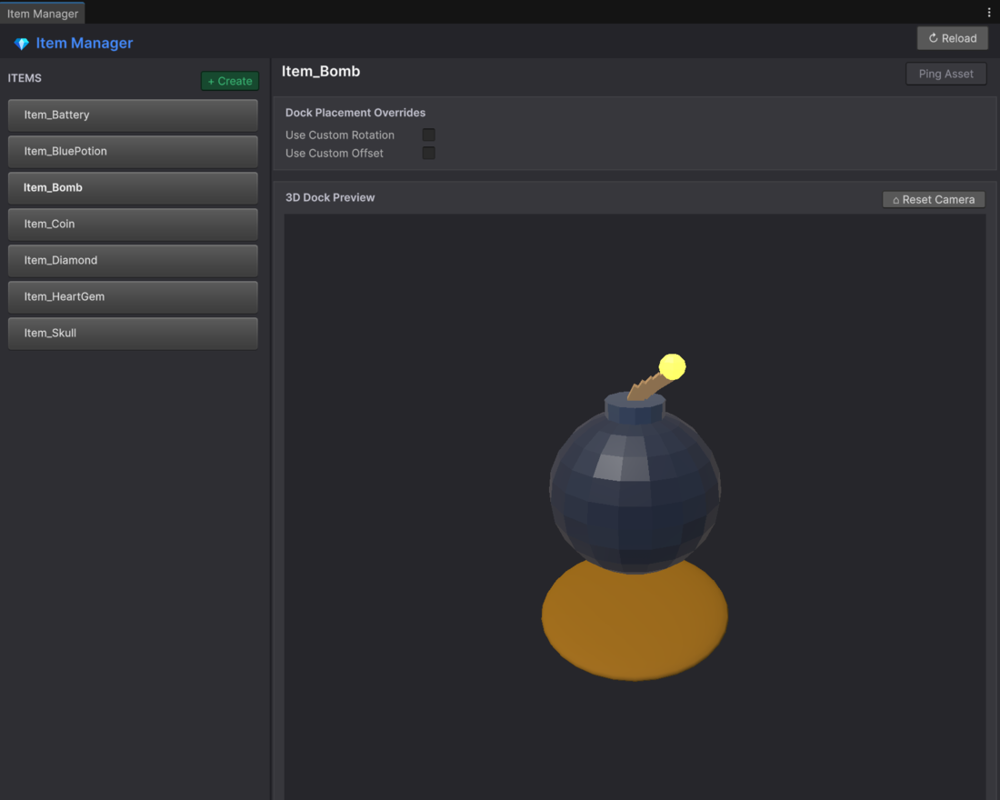

### Make a new item

1. Click **+ Create**.
2. **Item Name Type**: pick a name, or click **New Type…**, type a name (for example `Star`) and click **Add**.
   Unity recompiles after you add a type.
3. **3D Model Prefab**: drag in your model.
4. Leave **Auto-Generate Icon** on to render the goal-card icon from the model. Adjust **Model Rotation**,
   **Zoom Padding** and **Camera Offset** until the preview looks right. Or turn it off and assign your own sprite.
5. Click **🚀 Generate Item Prefab**. You get `_START_HERE/Items/Item_<Name>.prefab`, with the collider,
   Rigidbody, `Item` component and layer already set.
6. The item now shows in the Template Editor's Prefab Library. Add it to a level.

### Make it sit nicely in the tray

If the item looks tilted or off-centre in the tray, select it and tick **Use Custom Rotation** and/or
**Use Custom Offset** under *Dock Placement Overrides*. The **3D Dock Preview** updates as you type.

> **Use one material per model.** When the player taps an item, its outline is added as a second material.
> A model with several materials (or sub-meshes) loses its colours when tapped. Bake the colours into one
> texture or one palette material first.

---

## 6. Set up the shop (Shop Manager)

Open **Match Them All ▸ Shop Manager**.

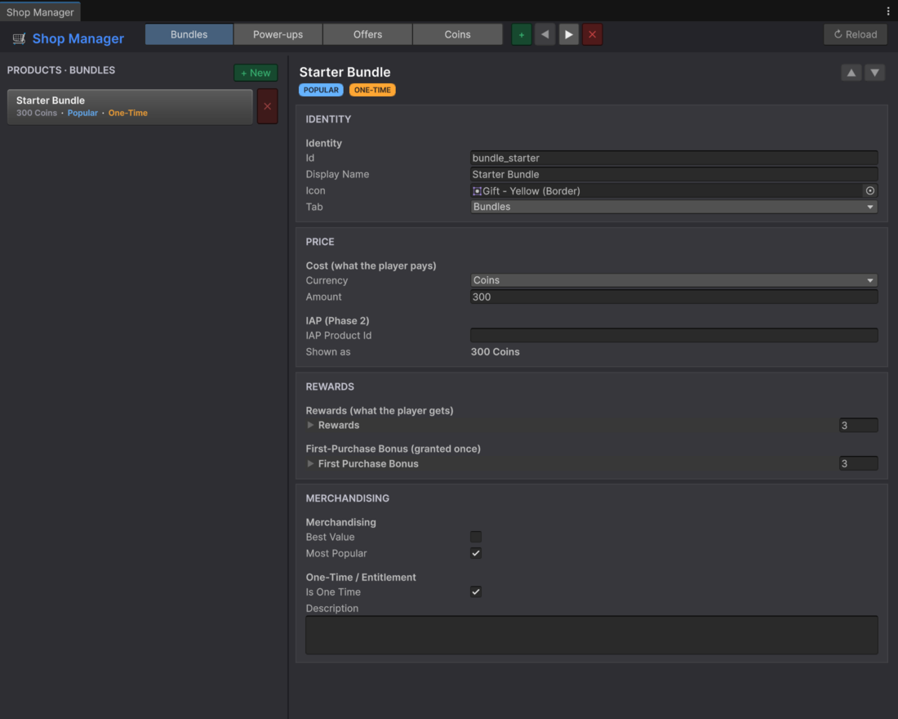

- The buttons along the top are the **shop tabs** (Bundles, Power-ups, Offers, Coins). Use **+** to add a
  tab, **◀ ▶** to reorder and **✕** to delete.
- **+ New** adds a product to the selected tab. **▲ ▼** (top right of a product) set its order on the tab.

| Section | Fields |
|---|---|
| **Identity** | **Id** (unique, never change it after release: the save file uses it), **Display Name**, **Icon**, **Tab**. |
| **Price** | **Currency** and **Amount** for a coin price. For real money, fill in **IAP Product Id** (see section 10). The card then shows the store price, and *Amount* is ignored. |
| **Rewards** | A list of what the player gets. Each entry is *Coins*, *Gems*, *Powerup Charge* (set the power-up id, e.g. `vacuum`) or *Entitlement* (a permanent unlock key). **First-Purchase Bonus** is added once, on the first purchase only. |
| **Merchandising** | **Best Value** / **Most Popular** badges. **Is One Time** sells the product once (for example a starter pack or *remove ads*). |

**Remove ads:** give a product an *Entitlement* reward with the key `remove_ads`. Once bought, interstitials
stop and the free-coin video button hides. Rewarded placements still grant their reward, without the video.

---

## 7. Change sounds and music (Sound Manager)

Open **Match Them All ▸ Sound Manager**.

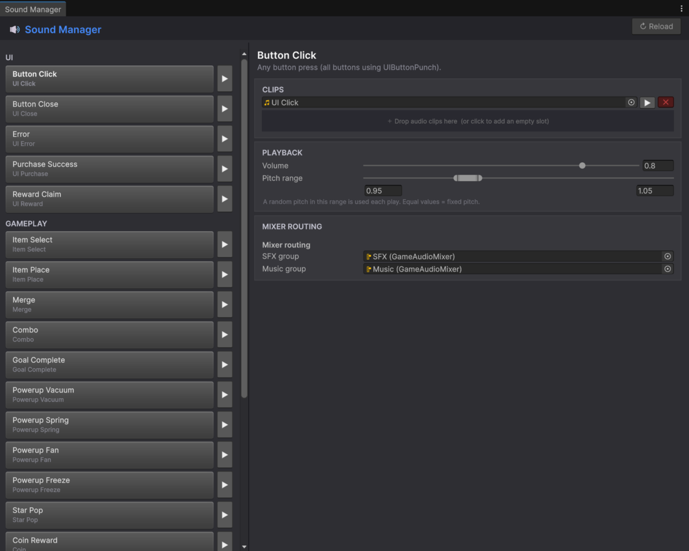

1. Pick a sound on the left. The **▶** button plays it.
2. Drag one or more clips into **Clips**. With several clips, one is picked at random each time.
3. Set **Volume** and **Pitch range**. Equal min and max values give a fixed pitch.

**Mixer routing** sends sound effects and music to the `SFX` and `Music` groups of `GameAudioMixer`. The
volume sliders in the game's Settings panel control those groups.

---

## 8. Power-ups

The four power-ups are assets in `Resources/Powerups/`. Select `Powerup_vacuum.asset` (or another) to edit it
in the Inspector:

| Field | What it does |
|---|---|
| **Id** | Unique key (`vacuum`, `spring`, `fan`, `freeze`), used by the save file and tutorials. |
| **Order** | Position in the power-up bar, from left to right. |
| **Unlock Level** | The level (0-based) at which it unlocks. |
| **Default Amount** | Free charges on the first launch. |
| **Buy Currency / Buy Cost** | Price offered in the popup when the player taps it with 0 charges. |
| **Effect** | The behaviour and its tuning values (forces, timings, VFX). |

At 0 charges the button shows a video icon. Tapping it opens a popup: **buy with coins** or **watch an ad**.
Coins are never spent without the player choosing to.

### Add your own power-up

1. Write a class that derives from `PowerupEffect` (see `SpringEffect.cs` for a full example):

   ```csharp
   using System;
   using MatchThemAll.Scripts.Power_Ups;

   [Serializable]
   public class ShuffleTrayEffect : PowerupEffect
   {
       public override bool CanActivate(PowerupContext ctx) =>
           ctx.ItemSpots != null && ctx.ItemSpots.GetRandomOccupiedSpot();

       public override void Activate(PowerupContext ctx)
       {
           ctx.SetBusy(true);      // blocks other power-ups while yours runs
           // ... your effect, using only what ctx gives you ...
           ctx.SetBusy(false);     // call this when the effect ends (in OnComplete for tweens)
       }
   }
   ```

2. *Create ▸ Match Them All ▸ Powerup Data*. Fill in Id, Display Name, Icon and UI Prefab (copy one from an
   existing power-up), then pick your class in the **Effect** drop-down.
3. Add the new asset to the `powerups` list of `Resources/Powerups/PowerupDatabase.asset`. The bar adds the
   slot and lays itself out.

You don't need to edit an enum or a switch statement.

---

## 9. Daily rewards and global settings

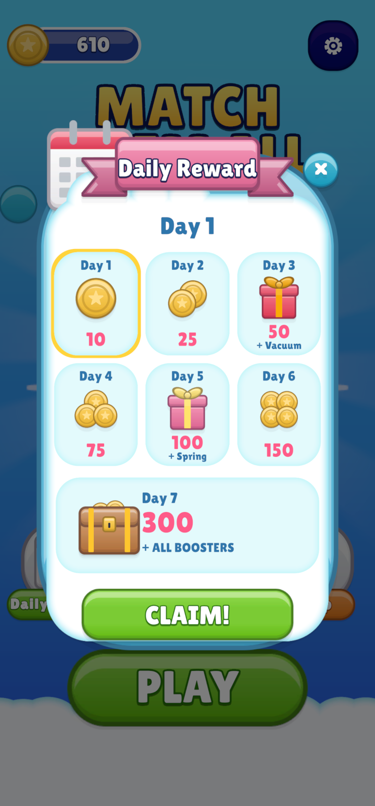

**Daily rewards** run a 7-day streak. Missing a day restarts it at day 1. The rewards are set in
`Scripts/Runtime/Core/DailyRewardManager.cs` (`GrantReward`, one `case` per day). The labels on the panel are
in the `DailyRewardPanel` prefab. If you change a reward, change both.

**Global settings** (`Resources/GameSettings.asset`, or the Template Editor's **Settings** tab):

| Field | Default | What it does |
|---|---|---|
| Continue Coin Cost | 900 | Coins to continue when time runs out |
| Continue Time Bonus | 30 | Seconds added on continue |
| Allow Ad Continue | on | Also offer "watch an ad to continue" |

<br clear="right">

---

## 10. Ads and in-app purchases

Out of the box, the template runs with **mock ads** (a 1-second fake video) and the coin shop. Real ads and
real-money purchases turn on when you install their packages. You don't change any code.

| Install (Package Manager ▸ Unity Registry) | Turns on |
|---|---|
| **Ads Mediation** (LevelPlay 9.5+) | Rewarded and interstitial ads |
| **In-App Purchasing** (Unity IAP 5+) | Real-money shop products, Restore Purchases (iOS) |

All keys and switches are in `Resources/Monetization/MonetizationSettings.asset`:

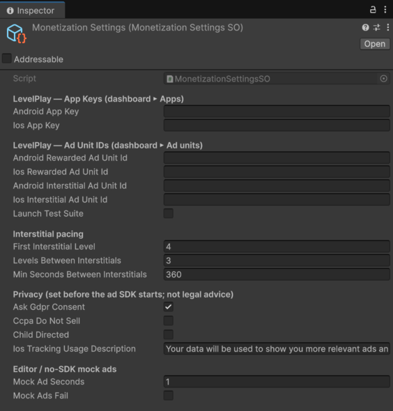

| Section | What to fill in |
|---|---|
| **LevelPlay App Keys / Ad Unit IDs** | From the LevelPlay dashboard, for Android and iOS separately. |
| **Interstitial pacing** | No interstitial before **First Interstitial Level**, then at most one every **Levels Between Interstitials**, and never more often than **Min Seconds Between Interstitials**. |
| **Privacy** | **Ask Gdpr Consent** shows the consent popup on first launch. **Ccpa Do Not Sell** and **Child Directed** (COPPA) report those settings to the ad SDK. **Ios Tracking Usage Description** is the iOS tracking prompt text. |
| **Mock ads** | Video length, and **Mock Ads Fail** to test the "no ad available" path. |

Where ads show: Continue when out of time (rewarded), power-up with 0 charges (rewarded), and between levels
(interstitial, paced).

The full setup, with store product ids, Restore Purchases, the iOS tracking prompt and testing, is in
**[MONETIZATION_SETUP.md](MONETIZATION_SETUP.md)**. It is technical setup, not legal advice.

---

## 11. Build for Android / iOS

1. *File ▸ Build Profiles*: switch to **Android** or **iOS**. All five scenes must be listed, with
   `OpenScene` first.
2. **Build the level data:** *Window ▸ Asset Management ▸ Addressables ▸ Groups ▸ Build ▸ New Build ▸
   Default Build Script*. Repeat this every time you add or change a level. The player build doesn't do it
   for you, and a build without it ships with no levels.
3. If you installed Ads Mediation, resolve its native dependencies (the Android Resolver / iOS Resolver
   menus), and see MONETIZATION_SETUP.md for the Android `AD_ID` permission and the iOS settings.
4. Set your company name, product name, bundle id and icons in *Project Settings ▸ Player*.
5. Build and test on a device.

---

## 12. Troubleshooting

| Problem | Fix |
|---|---|
| The map is empty, or `InvalidKeyException … List`1[System.String]` | The level isn't in Addressables, or no Addressables build exists. Create levels with **+ New** (it registers them), then run *New Build ▸ Default Build Script* (section 11, step 2). |
| The UI looks stretched in Play mode | The Game view is on Free Aspect. Pick a portrait resolution or use the Device Simulator. |
| An item loses its colours when tapped | Its model has more than one material. Use one material (section 5). |
| An item sits crooked in the tray | Use the Item Manager's *Dock Placement Overrides*. |
| The Amount field shows a warning | Amounts must be multiples of 3. |
| Real-money products show "…" and can't be bought | In-App Purchasing isn't installed, the store isn't reachable, or the IAP Product Id doesn't match the store. |
| No ads in the Editor with LevelPlay installed | LevelPlay only runs with an Android or iOS build target. On PC/Mac the template uses mock ads. |
| Progress or coins look wrong while testing | The save is `save.json` in `Application.persistentDataPath`. Delete it (with the game stopped) to start fresh. |

For programmers: `ARCHITECTURE_OVERVIEW.md` explains the event bus and managers, and `API_REFERENCE.md`
lists the public classes.
