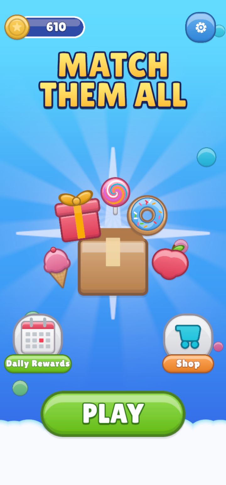
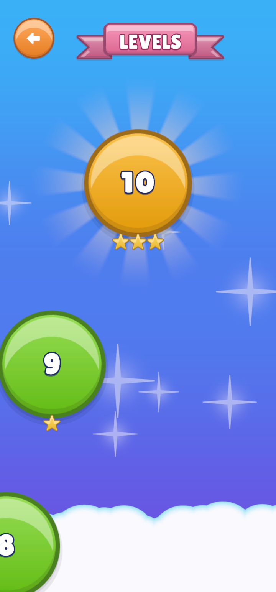

# First Run

1. **Open the start scene.** In the Project window, go to `Assets/MatchThemAllTemplate/Scenes/` and
   double-click **OpenScene**. The game always starts from this scene.
2. **Make the screen phone-shaped.** The game is made for a tall phone screen. Pick one of these:
   - Open *Window ▸ General ▸ Device Simulator* and choose a phone, **or**
   - In the **Game** tab, open the aspect drop-down (it says *Free Aspect*) and pick a portrait size such as
     **1440×3088**.

   On a wide screen the buttons look squashed.
3. **Press Play** (the ▶ button at the top of Unity). The game opens in the Lobby. Tap **Play**, choose a level
   on the map, and play.

  
  

> **Jump straight into one level:** open the [Template Editor](../03-Editor-Tools/Template-Editor/README.md),
> select a level, and click **▶ Play Level**.

---
[↑ Getting Started](README.md) · Next: [How the Game Plays →](../02-How-The-Game-Plays/README.md)
