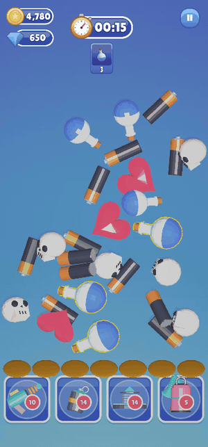
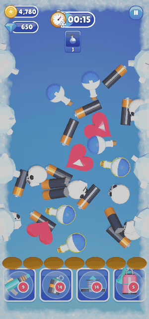
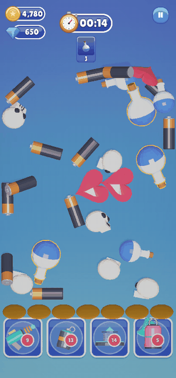
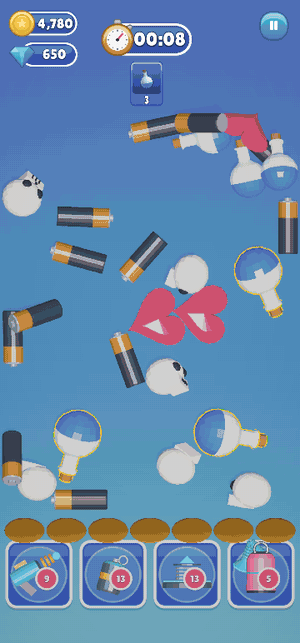

# Power-ups

The power-up bar sits under the tray. Each button shows how many **charges** the player has left. A power-up
**unlocks** at a set level (a padlock shows the level until then), and the first time it unlocks, a short
tutorial points at it.

| Freeze Gun | Fan | Spring | Vacuum |
|:---:|:---:|:---:|:---:|
|  |  |  |  |
| Fires a laser and **stops the clock** for a while. Frost shows on the screen and a bar inside the timer shows the time left. | **Blasts every item** in the pile in a new direction, to dig out hidden ones. | **Bounces one item from the tray** back onto the board, to free a slot. Needs at least one item in the tray. | **Sucks up items you still need** for a goal. Here it collects the last ones, and the level is won. |
| Unlocks at level 2 | Unlocks at level 3 | Unlocks at level 4 | Unlocks at level 5 |

**Out of charges?** The button shows a video icon. Tapping it opens a popup where the player chooses: pay
coins, or watch an ad for a free charge. Coins are never spent without the player choosing to.

> Change prices, starting charges, unlock levels, sounds and the order of the bar in the
> [Power-up Manager](../03-Editor-Tools/Power-up-Manager/README.md).

---
[↑ How the Game Plays](README.md) · Next: [Win and Lose →](Win-and-Lose.md)
