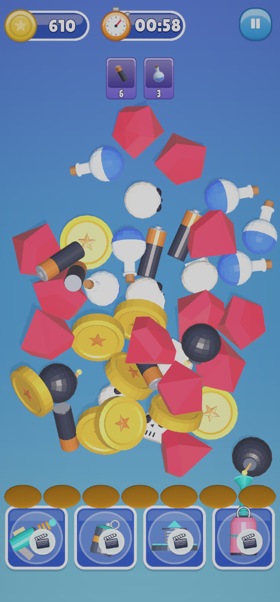

# 2. How the Game Plays

A level is a pile of 3D items. The player taps items to move them into a tray at the bottom. **Three of the
same item in the tray merge and disappear.** Collect every item shown on the goal cards before the timer runs
out to win.

  

*A level at the start: coins and gems (top left), the **timer**, the **goal cards** (what to collect), the
**pile** of items, the empty **tray**, and the **power-up bar** at the bottom.*

| Page | What it shows |
|---|---|
| [Tap and Match](Tap-and-Match.md) | Moving items to the tray, merging three, and completing a goal |
| [Power-ups](Power-ups.md) | What each of the four power-ups does |
| [Win and Lose](Win-and-Lose.md) | Winning with stars, Game Over, and running out of time |

---
[↑ User Guide](../README.md) · Next: [Tap and Match →](Tap-and-Match.md)
