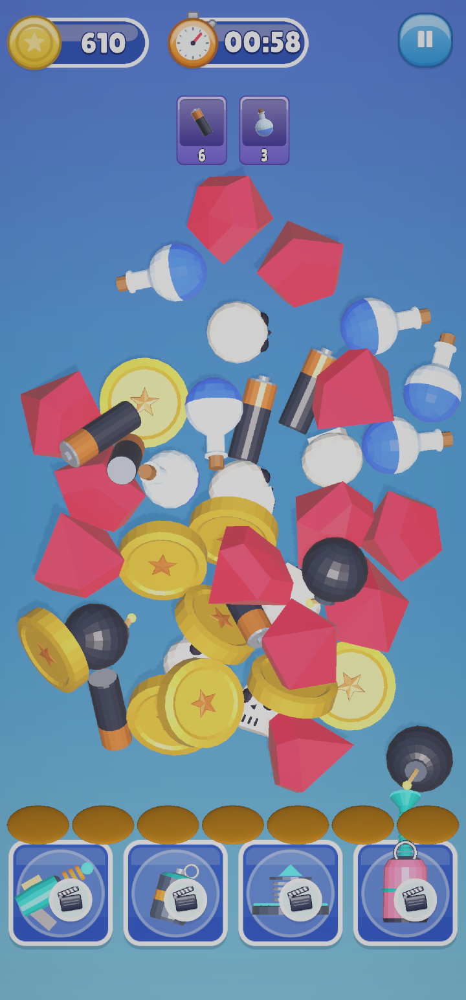

# 2. How the Game Plays

A level is a pile of 3D items. The player taps items to send them to a tray at the bottom, and any three of the
same item in the tray merge and disappear. To win, collect every item on the goal cards before the timer runs out.

  

*A level at the start. Top left are the coins and gems, then the timer and the goal cards (what to collect).
Below them are the pile of items, the empty tray, and the power-up bar at the bottom.*

| Page | What it shows |
|---|---|
| [Tap and Match](Tap-and-Match.md) | Moving items to the tray, merging three, and completing a goal |
| [Power-ups](Power-ups.md) | What each of the four power-ups does |
| [Win and Lose](Win-and-Lose.md) | Winning with stars, Game Over, and running out of time |

---
[↑ User Guide](../README.md) · Next: [Tap and Match →](Tap-and-Match.md)
