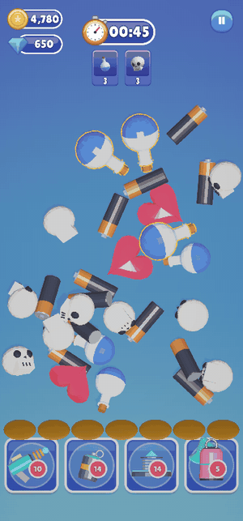

# Tap and Match

  

1. **Tap an item** in the pile. It slides into the tray, next to any items of the same kind.
2. **Three of a kind merge.** They pop and free their tray slots.
3. **Goal cards count down.** Each card at the top shows an item and how many are left. Merging three of that item
   lowers the number. When it reaches 0, the card is done and disappears.

Items that aren't on a goal card are **fillers**: they still merge in threes, but they don't count towards
winning. They make the right items harder to find.

> You decide which items are goals, how many there are, and how many fillers to add, in the
> [Template Editor](../03-Editor-Tools/Template-Editor/Items-in-a-Level.md).

---
[↑ How the Game Plays](README.md) · Next: [Power-ups →](Power-ups.md)
