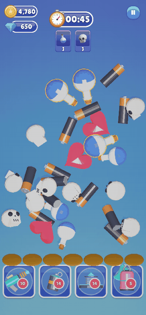

# Tap and Match

  

1. Tap an item in the pile. It slides into the tray, next to any items of the same kind.
2. When three of a kind are in the tray, they merge. They pop and free their slots.
3. Each goal card at the top shows an item and how many are left. Every merge of that item lowers the number, and
   at 0 the card is done and disappears.

Items that aren't on a goal card are fillers. They still merge in threes but don't count toward winning. Their only
job is to make the right items harder to find.

> You choose which items are goals, how many there are, and how many fillers to add in the
> [Template Editor](../03-Editor-Tools/Template-Editor/Items-in-a-Level.md).

---
[↑ How the Game Plays](README.md) · Next: [Power-ups →](Power-ups.md)
