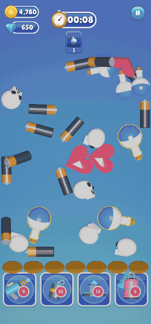
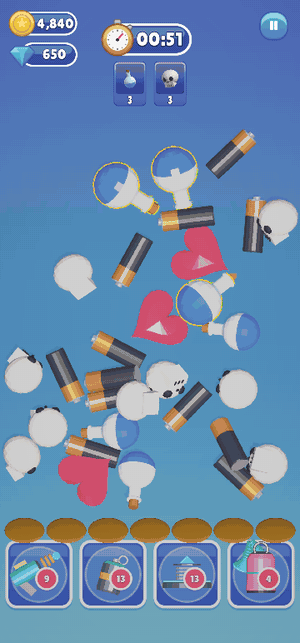

# Win and Lose

| Level Complete | Game Over |
|:---:|:---:|
|  |  |

## Win: Level Complete

The player wins when every goal card reaches 0.

- Stars (1 to 3) depend on how much time is left. Any win earns at least 1 star.
- Coins are paid out on the win screen.
- **Next Level** opens the next level. **Level Select** goes back to the map, where the stars are shown.

You set the star times and the coin reward for each level in the
[Template Editor](../03-Editor-Tools/Template-Editor/Level-Settings-and-Rewards.md).

## Lose: Game Over

The player loses when the tray is full and has no three of a kind. Nothing can merge, and there's no room for
another item. **Retry** restarts the level, and **Level Select** goes back to the map.

## Out of time

When the timer hits 0, the player gets one chance to continue: pay coins, or watch an ad, for some extra seconds.
If they decline, the level is lost. The price and the extra time are in
[Daily Rewards and Settings](../04-Daily-Rewards-and-Settings/Continue-Settings.md).

---
[↑ How the Game Plays](README.md) · Next: [Editor Tools →](../03-Editor-Tools/README.md)
