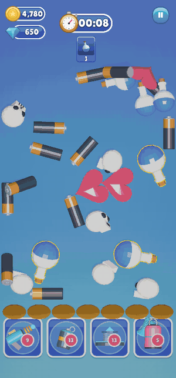
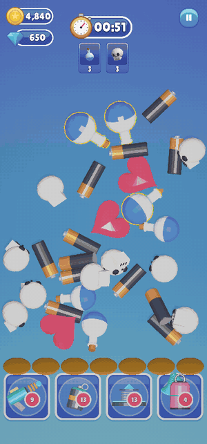

# Win and Lose

| Level Complete | Game Over |
|:---:|:---:|
|  |  |

## Win: Level Complete

The level is won when **every goal card reaches 0**.

- **Stars (1 to 3)** depend on how much time is left. Any win earns at least 1 star.
- **Coins** are paid out on the win screen.
- **Next Level** opens the next level. **Level Select** goes back to the map, where the stars are shown.

You set the star times and the coin reward per level in the
[Template Editor](../03-Editor-Tools/Template-Editor/Level-Settings-and-Rewards.md).

## Lose: Game Over

The game is lost when **the tray is full and holds no three of a kind**: nothing can merge, so there's no room
for another item. **Retry** restarts the level. **Level Select** goes back to the map.

## Out of time

When the timer reaches 0, the player gets one chance to **continue**: pay coins, or watch an ad, for extra
seconds. If they say no, the level is lost. The price and the extra time are in
[Daily Rewards and Settings](../04-Daily-Rewards-and-Settings/Continue-Settings.md).

---
[↑ How the Game Plays](README.md) · Next: [Editor Tools →](../03-Editor-Tools/README.md)
