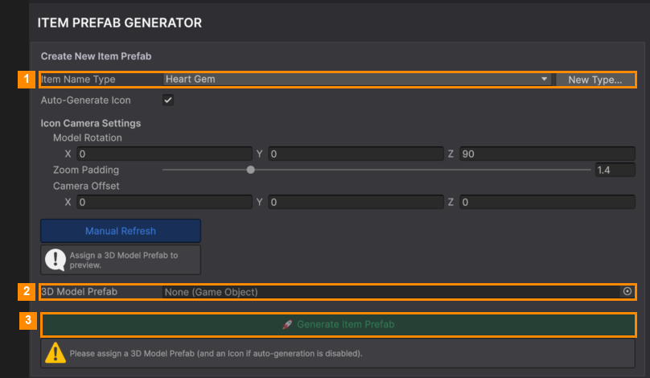
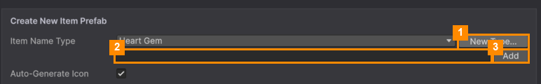
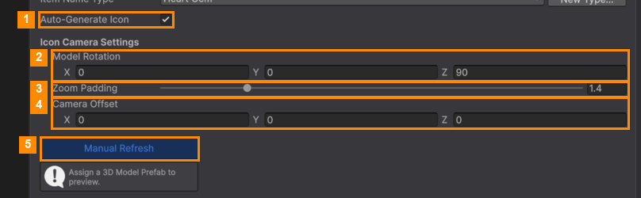

# Create an Item

Click **+ Create** in the Item Manager. The right side turns into the **Item Prefab Generator**.

### Step 1: Name the item type

Pick a name from **Item Name Type** (1). If the name you want isn't there, add it:

1. Click **New Type...** (1).
2. Type the name, for example `Star` (2).
3. Click **Add** (3). Unity reloads its scripts for a few seconds. When it's done, pick the new name in
   **Item Name Type**.

### Step 2: Add your model

Drag your model from the Project window into **3D Model Prefab** (2 in the first picture).

### Step 3: The icon

The goal cards show a small picture of the item.

With **Auto-Generate Icon** on (1), the icon is made from your model. Adjust it until the preview looks right:

| # | Setting | What it does |
|---|---|---|
| 2 | **Model Rotation** | Turns the model for the picture (degrees on X, Y, Z). |
| 3 | **Zoom Padding** | More padding makes the model smaller in the picture, with more space around it. |
| 4 | **Camera Offset** | Moves the picture's camera. |
| 5 | **Manual Refresh** | Redraws the preview if it didn't update by itself. |

With **Auto-Generate Icon** off, drag your own image into **UI Icon (Sprite)**.

### Step 4: Generate

Click **🚀 Generate Item Prefab** (3 in the first picture). The new item is saved as
`_START_HERE/Items/Item_<Name>.prefab` and is ready to play, with physics, collider and settings already set up.

It now shows up in the Template Editor's Prefab Library, where you can add it to a level
([Items in a Level](../Template-Editor/Items-in-a-Level.md)).

> If the button is greyed out with a message, you haven't added a model yet (or an icon, if Auto-Generate Icon is
> off).

---
[↑ Item Manager](README.md) · Next: [Dock Placement →](Dock-Placement.md)
