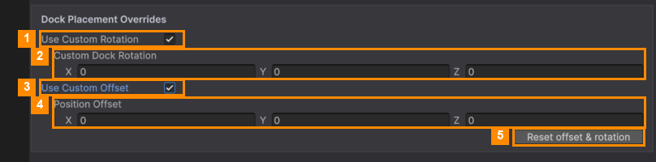

# Dock Placement

When an item lands in the tray, it's turned to face the player. Some models end up tilted, sideways or
off-centre. Fix that per item here.

1. Select the item in the ITEMS list.
2. Tick **Use Custom Rotation** (1), then set **Custom Dock Rotation** (2): degrees on X, Y and Z.
3. Tick **Use Custom Offset** (3), then set **Position Offset** (4) to move the item: X right, Y up, Z back.
4. Watch the **3D Dock Preview**. It updates as you type.
5. Made a mess? **Reset offset & rotation** (5) turns both options off and sets them back to zero.

Changes are saved straight away.

---
[↑ Item Manager](README.md) · Next: [Tray Slot Look →](Tray-Slot-Look.md)
