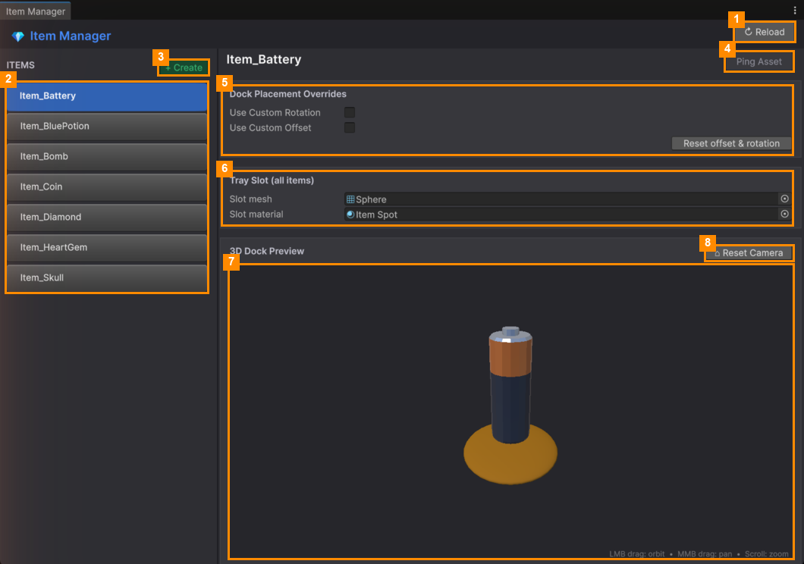

# Item Manager

**Open it:** *Match Them All ▸ Item Manager*. Use it to turn your 3D models into game items, and to make items
sit nicely in the tray.

| # | Part | What it does |
|---|---|---|
| 1 | **↻ Reload** | Reloads the item list, for example after adding item files by hand. |
| 2 | **ITEMS list** | Every item in the game. Click one to see and adjust it. |
| 3 | **+ Create** | Opens the item maker ([Create an Item](Create-an-Item.md)). |
| 4 | **Ping Asset** | Highlights the item's file in the Project window. |
| 5 | **Dock Placement Overrides** | Turns or moves this item when it sits in the tray ([Dock Placement](Dock-Placement.md)). |
| 6 | **Tray Slot (all items)** | The look of the tray slots that items sit on ([Tray Slot Look](Tray-Slot-Look.md)). |
| 7 | **3D Dock Preview** | The item sitting on a tray slot, as in the game. **Left-drag** to turn the view, **middle-drag** to move it, **scroll** to zoom. |
| 8 | **⌂ Reset Camera** | Puts the preview view back where it started. |

## Pages

| Page | What it covers |
|---|---|
| [Create an Item](Create-an-Item.md) | Making a new item from a 3D model, with an automatic icon |
| [Dock Placement](Dock-Placement.md) | Fixing an item that sits tilted or off-centre in the tray |
| [Tray Slot Look](Tray-Slot-Look.md) | Changing the shape and material of the tray slots |

> **One material per model.** When the player taps an item, an outline is added as a second material. A model
> with several materials loses its colours when tapped. Combine its colours into one material first.

---
[↑ Editor Tools](../README.md) · Next: [Create an Item →](Create-an-Item.md)
