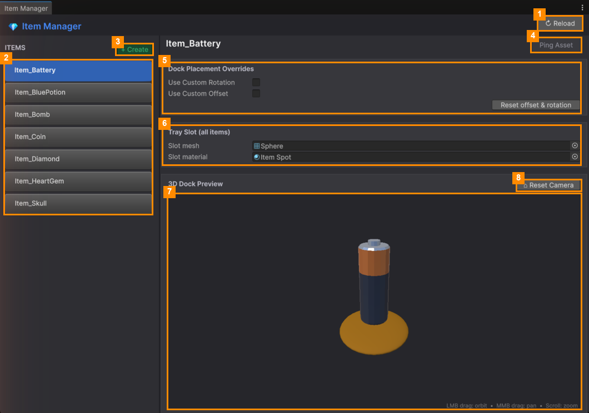

# Tray Slot Look

The tray slots are the round pads items sit on at the bottom of the screen. All slots share one look, which you
can change from any item in the Item Manager.

The **Tray Slot (all items)** card (6) has two fields:

| Field | What it does |
|---|---|
| **Slot mesh** | The shape of the slot. Drag in any mesh from your project. |
| **Slot material** | The colour or texture of the slot. Drag in any material. |

The change is saved straight away, and applies to **every** slot in every level. The preview below shows it
immediately.

> To undo, pick the previous mesh or material again. The originals are the **Sphere** mesh and the
> **Item Spot** material (`Art/Materials/Item Spot`).

---
[↑ Item Manager](README.md) · Next: [Shop Manager →](../Shop-Manager/README.md)
