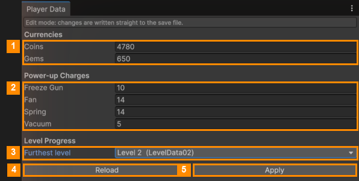
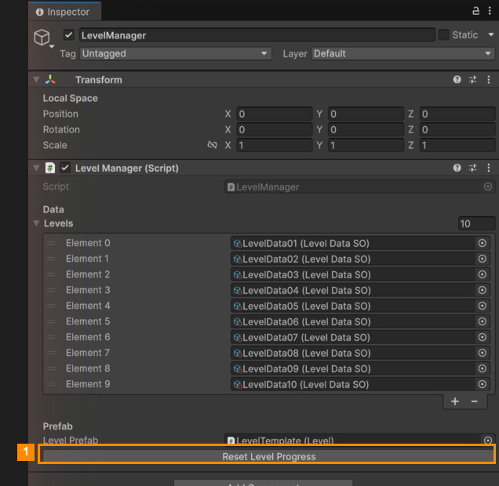

# Player Data

**Open it:** *Match Them All ▸ Player Data*. This window changes **your own test save** on this computer. It
doesn't affect players. Use it to test the shop with lots of coins, to try a power-up at 0 charges, or to replay
the unlocks from the start.

| # | Field | What it does |
|---|---|---|
| 1 | **Coins** / **Gems** | How many you have. |
| 2 | **Power-up Charges** | Charges for each power-up. Set one to 0 to test the "buy or watch an ad" popup. |
| 3 | **Furthest level** | How far you've got. Levels after it are locked, and so are power-ups that unlock later. **Level 1 is like a fresh start.** Moving it back also clears the stars of that level and later ones, while earlier levels keep theirs. |
| 4 | **Reload** | Reads the save again, throwing away what you typed. |
| 5 | **Apply** | Writes your values to the save. Works with the game stopped or running. While the game runs, the power-up bar updates straight away. |

> **Start completely fresh:** select the **LevelManager** object in `MainScene` and click
> **Reset Level Progress** (1) in the Inspector. This deletes the whole save: coins, gems, charges and progress.

---
[↑ Editor Tools](../README.md) · Next: [Daily Rewards and Settings →](../../04-Daily-Rewards-and-Settings/README.md)
