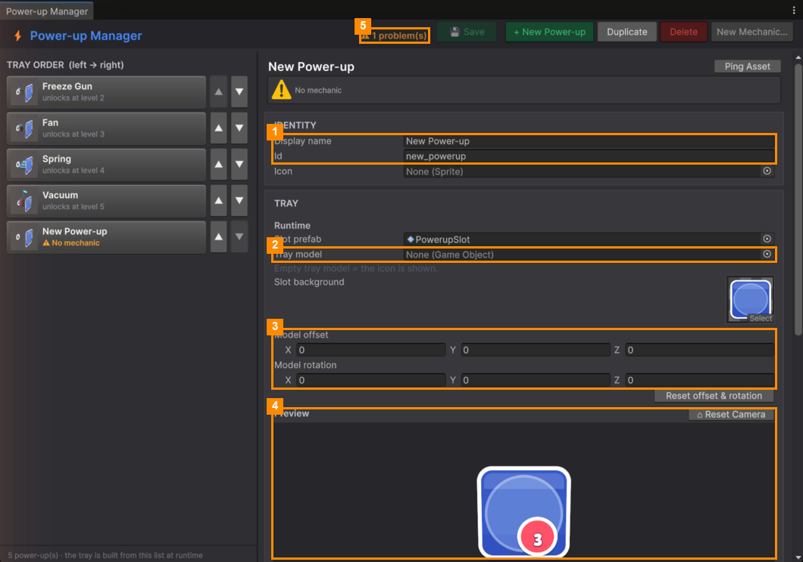

# Add a Power-up

You can add a power-up that uses one of the four built-in behaviours with different settings, for example a
"Big Freeze" that freezes the clock for longer and costs more.

### Step 1: Make it

- **+ New Power-up** makes an empty one: 3 starting charges, unlocked from level 1, using **PowerupSlot**. **Or**
- Select a power-up and click **Duplicate** to start from a copy of it.

It's added to the end of the bar, with a temporary id such as `new_powerup`.

### Step 2: Fill it in

1. Give it a **Display name** and a unique **Id** (1).
2. Pick an **Icon**, or drag a 3D model into **Tray model** (2). Adjust **Model offset** and
   **Model rotation** (3) until it sits nicely in the preview (4).
3. Pick a **Mechanic** and tune its settings.
4. Set **Unlocks at level**, **Starting charges**, **Currency** and **Price**.
5. Choose an **Activate sound** and effects.
6. Click **💾 Save**.

Until everything needed is filled in, the toolbar counts it as a problem (5) and the power-up shows a ⚠ warning,
such as *No mechanic* or *No icon or tray model*.

### Change the order of the bar

Use **▲ / ▼** in the TRAY ORDER list. The top of the list is the left end of the bar.

### Delete a power-up

Select it and click **Delete**. The window asks first, then moves the file to your computer's Recycle Bin.

### Add a tutorial for it

Add a step on its unlock level in the [Template Editor](../Template-Editor/Tutorial-Steps.md): Highlight Target
*Powerup*, its **Id**, and Completion Condition *On Powerup Used*.

---
[↑ Power-up Manager](README.md) · Next: [New Mechanic →](New-Mechanic.md)
