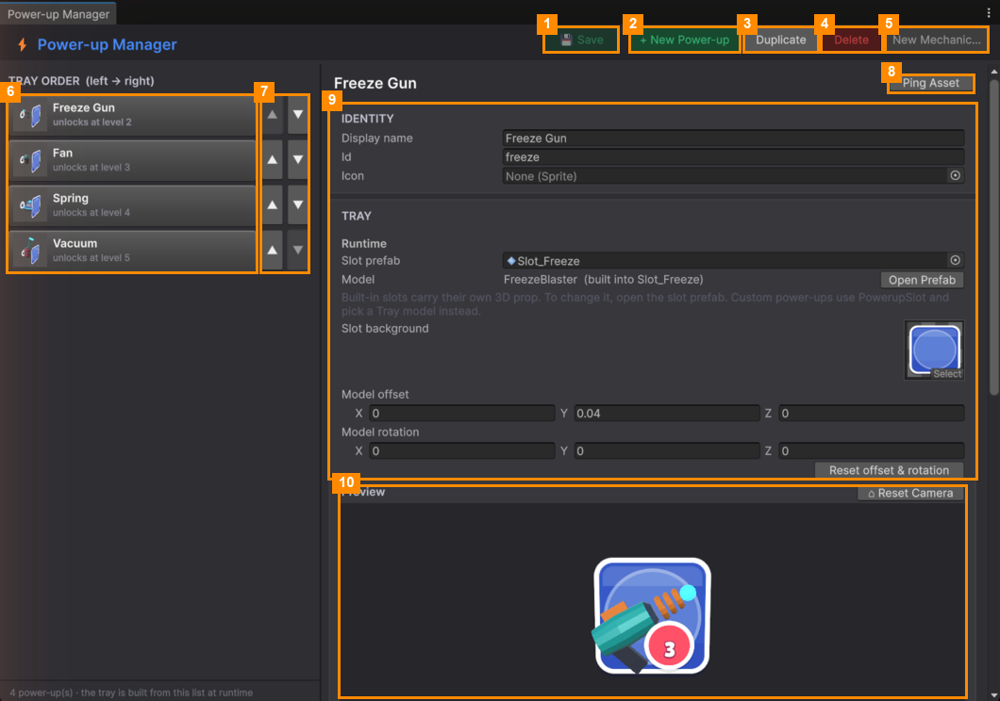
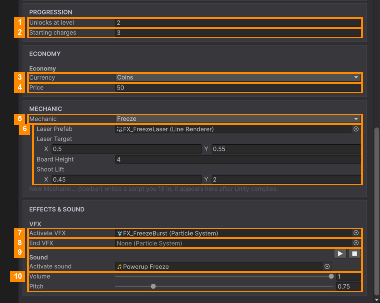

# Edit a Power-up

Select a power-up in the TRAY ORDER list. Its settings are grouped into sections.

### Identity

| Field | What it does |
|---|---|
| **Display name** | The name shown to players. |
| **Id** | A unique key, such as `freeze`. Tutorials and the shop use it, and the save file stores charges by it. Use lowercase letters, digits and `_` only. **Changing it after release gives players the starting charges again**, so the window asks first. |
| **Icon** | A picture shown in the button when there's no 3D model. |

### Tray

| Field | What it does |
|---|---|
| **Slot prefab** | The button used in the bar. The four built-in power-ups have their own (`Slot_Freeze` and so on), with the 3D prop and its animation inside. New power-ups use **PowerupSlot**. |
| **Model** *(built-in power-ups)* | The 3D prop, built into the slot prefab. **Open Prefab** opens it if you want to change it. |
| **Tray model** *(PowerupSlot only)* | A 3D model to show in the button. Leave it empty to show the **Icon** instead. |
| **Slot background** | The picture behind **every** power-up button. Changing it changes all of them, and saves straight away. |
| **Model offset** | Moves the model inside its button: X right, Y up, Z away from the camera. |
| **Model rotation** | Turns the model around its own centre (degrees). |
| **Reset offset & rotation** | Sets both back to zero. |

### Progression

| # | Field | What it does |
|---|---|---|
| 1 | **Unlocks at level** | The level where it unlocks, as players count levels: 1 means from the start. Until then, the button shows a padlock and the level number. |
| 2 | **Starting charges** | Free charges a new player gets. |

### Economy

| # | Field | What it does |
|---|---|---|
| 3 | **Currency** | What the player pays with when out of charges: Coins or Gems. |
| 4 | **Price** | How much one charge costs. The player can also watch an ad instead. |

### Mechanic

| # | Field | What it does |
|---|---|---|
| 5 | **Mechanic** | What the power-up does: **Freeze**, **Fan**, **Spring**, **Vacuum**, or your own. Switching asks first, because its settings reset. |
| 6 | **Mechanic settings** | The fine-tuning values of that mechanic, such as how long the freeze lasts or how hard the fan blows. |

### Effects & Sound

| # | Field | What it does |
|---|---|---|
| 7 | **Activate VFX** | A visual effect played when the power-up starts. |
| 8 | **End VFX** | An optional effect played when it finishes. |
| 9 | **Activate sound** | The sound played when it starts. **▶** plays it, **■** stops it. |
| 10 | **Volume** / **Pitch** | How loud, and how high or low, that sound plays. |

Click **💾 Save** when you're done.

---
[↑ Power-up Manager](README.md) · Next: [Add a Power-up →](Add-a-Power-up.md)
