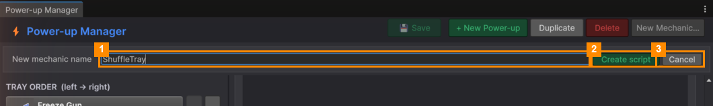

# New Mechanic (for programmers)

A **mechanic** is the code behind a power-up. You only need one when none of the four built-in mechanics
(Freeze, Fan, Spring, Vacuum) does what you want.

1. Click **New Mechanic…** in the toolbar.
2. Type a name in **New mechanic name** (1), for example `ShuffleTray`. Use letters and digits, not starting
   with a digit.
3. Click **Create script** (2), or **Cancel** (3). A ready-to-fill script is created, and Unity reloads.
4. Open the script and write two methods:
   - `CanActivate(ctx)`: return `true` when the power-up can be used right now.
   - `Activate(ctx)`: do the effect. Call `ctx.SetBusy(true)` at the start and `ctx.SetBusy(false)` at the end, so
     that two power-ups don't run at once.

   `SpringEffect.cs` is a complete example.
5. Back in the Power-up Manager, select your power-up and pick the new mechanic under **Mechanic**. Its public
   fields appear underneath, ready to tune.

You don't need to edit any lists or switch statements: the manager finds new mechanics by itself.

---
[↑ Power-up Manager](README.md) · Next: [Player Data →](../Player-Data/README.md)
