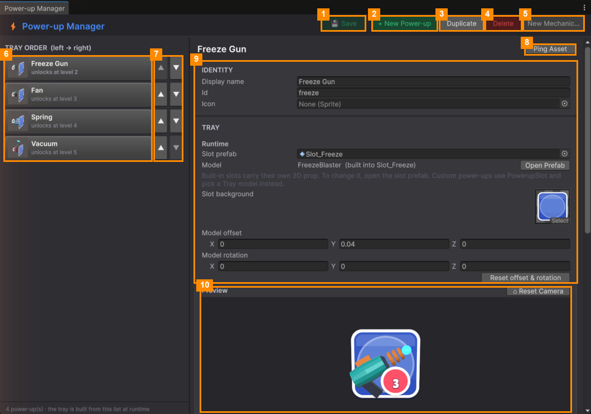

# Power-up Manager

**Open it:** *Match Them All ▸ Power-up Manager*. Everything about the power-ups is here: price, starting
charges, unlock level, look, sound and order in the bar. You can also add your own.

| # | Part | What it does |
|---|---|---|
| 1 | **💾 Save** | Saves your changes. Turns green when something is unsaved. |
| 2 | **+ New Power-up** | Adds a new power-up ([Add a Power-up](Add-a-Power-up.md)). |
| 3 | **Duplicate** | Copies the selected power-up. |
| 4 | **Delete** | Deletes the selected power-up, after asking. |
| 5 | **New Mechanic…** | For programmers: makes a script for a brand-new power-up behaviour ([New Mechanic](New-Mechanic.md)). |
| 6 | **TRAY ORDER list** | The power-ups in bar order, left to right. Shows each one's unlock level. Click one to edit it. |
| 7 | **▲ / ▼** | Moves a power-up left or right in the bar. |
| 8 | **Ping Asset** | Highlights the power-up's file in the Project window. |
| 9 | **Settings** | Identity, Tray, Progression, Economy, Mechanic, Effects & Sound ([Edit a Power-up](Edit-a-Power-up.md)). |
| 10 | **Preview** | The power-up's button as it looks in the game. **Left-drag** to turn, **middle-drag** to move, **scroll** to zoom. **⌂ Reset Camera** resets the view. |

If a power-up is missing something (an id, a mechanic, or a picture), the toolbar shows **⚠ … problem(s)**, the power-up shows ⚠ in the list, and the problem is explained at the top of its page. See the picture in [Add a Power-up](Add-a-Power-up.md).

## Pages

| Page | What it covers |
|---|---|
| [Edit a Power-up](Edit-a-Power-up.md) | Every setting, section by section |
| [Add a Power-up](Add-a-Power-up.md) | A new power-up with a built-in behaviour, and changing the bar order |
| [New Mechanic](New-Mechanic.md) | For programmers: a power-up that does something new |

> To test unlocks on your own save, use [Player Data](../Player-Data/README.md) ▸ **Furthest level**.

---
[↑ Editor Tools](../README.md) · Next: [Edit a Power-up →](Edit-a-Power-up.md)
