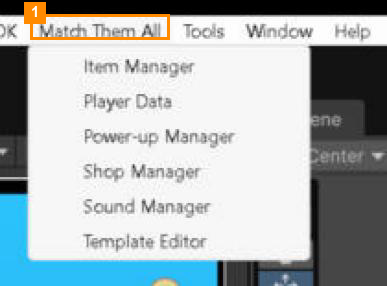

# 3. Editor Tools

All the tools are in the **Match Them All** menu at the top of Unity.

| Tool | Use it to… |
|---|---|
| [Template Editor](Template-Editor/README.md) | Make and edit **levels**: items, goals, timer, rewards, tutorials |
| [Item Manager](Item-Manager/README.md) | Add new **items** from your 3D models, and set how they sit in the tray |
| [Shop Manager](Shop-Manager/README.md) | Build the **shop**: tabs, products, prices and rewards |
| [Sound Manager](Sound-Manager/README.md) | Choose the **sounds and music** for every game event |
| [Power-up Manager](Power-up-Manager/README.md) | Edit the **power-ups**: price, unlock level, sound, order, or add your own |
| [Player Data](Player-Data/README.md) | Change **your own test save**: coins, gems, charges, level progress |

**Tips that apply to every tool**

- Open several tools at once and drag their tabs together to dock them side by side.
- **💾 Save** turns green when you have unsaved changes. **↻ Reload** throws away unsaved changes.
- **Ping Asset** highlights the file you're editing in the Project window.

---
[↑ User Guide](../README.md) · Next: [Template Editor →](Template-Editor/README.md)
