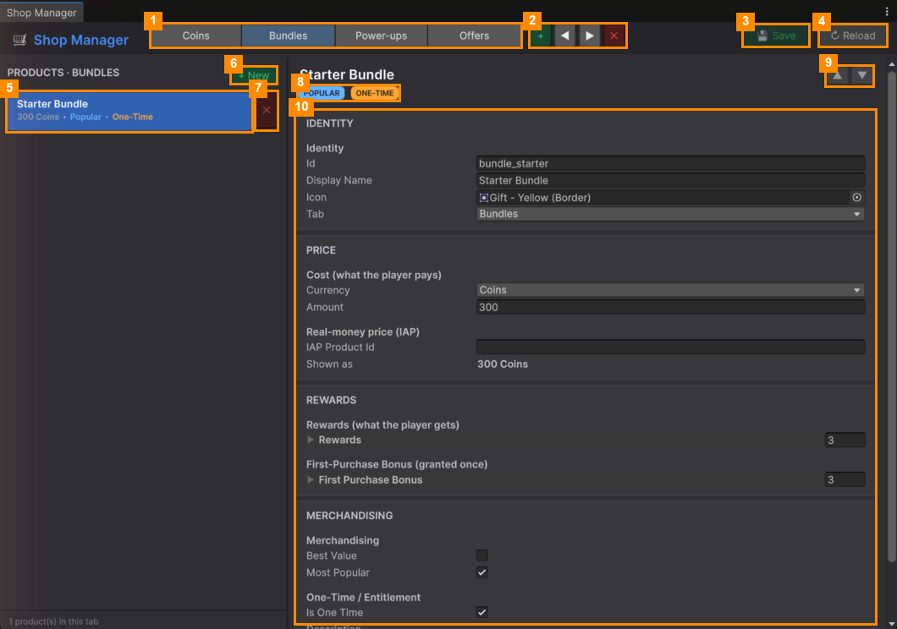
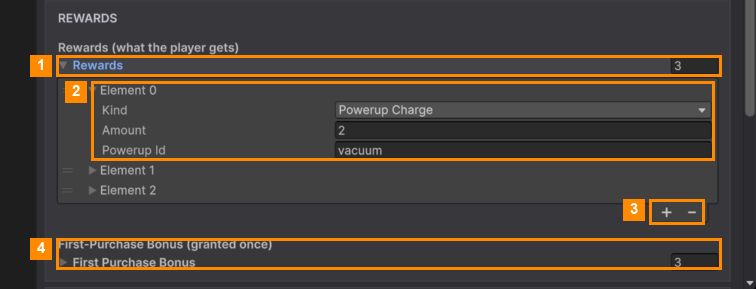
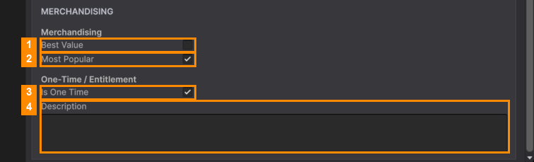

# Products

Select a product in the PRODUCTS list to edit it. To make one, click **+ New** above the list.

### Identity

| Field | What it does |
|---|---|
| **Id** | A unique name for the product, for example `coins_500`. **Don't change it after release**: the player's save remembers purchases by it. |
| **Display Name** | The name players see. |
| **Icon** | The picture on the shop card. |
| **Tab** | Which shop tab the product is on. Pick another to move it. |

### Price

| Field | What it does |
|---|---|
| **Currency** | What the player pays with: **Coins** or **Gems**. |
| **Amount** | How much. |
| **IAP Product Id** | Only for **real money**: the product id from Google Play / App Store Connect. When it's set, the card shows the store price and *Amount* is ignored. Leave it empty for coin and gem products. See [In-App Purchases](../../05-Ads-and-In-App-Purchases/In-App-Purchases.md). |
| **Shown as** | How the price will look on the card. Read-only. |

### Rewards

**Rewards** (1) is the list of what the player gets. Click the arrow to open it. Each entry (2) has a **Kind**, an
**Amount** and a **Powerup Id**. **+** and **−** (3) add or remove entries. Fill each entry in like this:

| Kind | Fill in |
|---|---|
| **Coins** / **Gems** | **Amount** |
| **Powerup Charge** | **Amount**, and the power-up id in **Powerup Id** (`freeze`, `fan`, `spring` or `vacuum`) |
| **Entitlement** | A permanent unlock. Put its key in **Powerup Id**, for example `remove_ads`. |

**First Purchase Bonus** (4) works the same way, but is given **only the first time** a player buys the product.

### Merchandising

| # | Field | What it does |
|---|---|---|
| 1 | **Best Value** | Shows a BEST VALUE badge on the card. |
| 2 | **Most Popular** | Shows a POPULAR badge. |
| 3 | **Is One Time** | The product can only be bought once, for example a starter pack. After buying, the card says *Owned*. |
| 4 | **Description** | A line of text on the card. |

### Selling "Remove Ads"

Make a product with **Is One Time** ticked and one **Entitlement** reward with the key `remove_ads`. Once
bought, the ads between levels stop and the free-coin video button hides. Rewarded features (continue, free
power-up charge) still give their reward, without the video.

---
[↑ Shop Manager](README.md) · Next: [Sound Manager →](../Sound-Manager/README.md)
