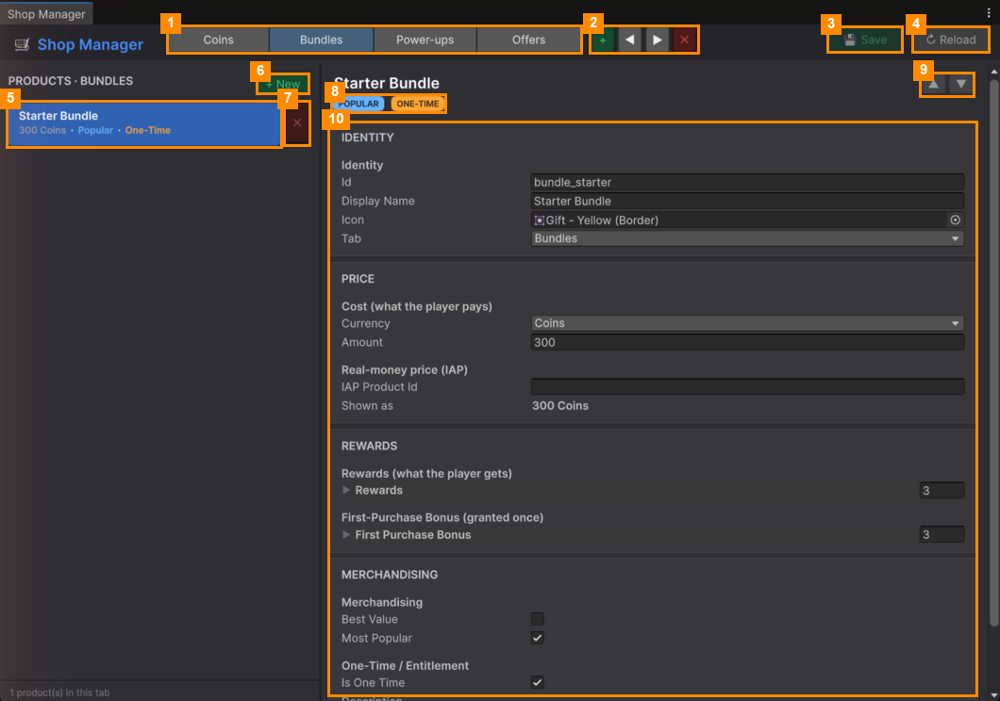

# Shop Manager

**Open it:** *Match Them All ▸ Shop Manager*. Use it to build the in-game shop: its tabs, and the products
on each tab.

| # | Part | What it does |
|---|---|---|
| 1 | **Shop tabs** | One button per tab in the in-game shop. Click one to see its products ([Shop Tabs](Shop-Tabs.md)). |
| 2 | **+ ◀ ▶ ✕** | Add a tab, move the selected tab left or right, remove it. |
| 3 | **💾 Save** | Saves your changes. Turns green when something is unsaved. |
| 4 | **↻ Reload** | Throws away unsaved changes. |
| 5 | **PRODUCTS list** | The products on the selected tab, with their price. Click one to edit it. |
| 6 | **+ New** | Adds a new product to this tab. |
| 7 | **✕** (red, next to a product) | Removes the product from the shop, after asking. |
| 8 | **Badges** | A quick view of the product: BEST VALUE, POPULAR, ONE-TIME, IAP. |
| 9 | **▲ ▼** | Moves the product up or down on its tab. |
| 10 | **Product details** | Everything about the product ([Products](Products.md)). |

The bottom of the list shows how many products are on the tab.

## Pages

| Page | What it covers |
|---|---|
| [Shop Tabs](Shop-Tabs.md) | Adding, ordering and removing tabs |
| [Products](Products.md) | A product's name, price, rewards and badges, and how to sell "Remove Ads" |

---
[↑ Editor Tools](../README.md) · Next: [Shop Tabs →](Shop-Tabs.md)
