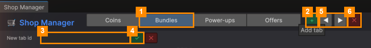

# Shop Tabs

The tabs along the top of the window are the tabs players see in the shop (Coins, Bundles, Power-ups,
Offers…).

| # | Button | What it does |
|---|---|---|
| 1 | A tab's name | Selects the tab and shows its products. |
| 2 | **+** | Adds a tab. Type a short id in **New tab id** (3), such as `specials`, and click **✓** (4). |
| 5 | **◀** / **▶** | Moves the selected tab left or right, the same as in the game. |
| 6 | **✕** | Removes the selected tab, after asking. **Its products are kept**: move them to another tab with each product's **Tab** field. |

---
[↑ Shop Manager](README.md) · Next: [Products →](Products.md)
