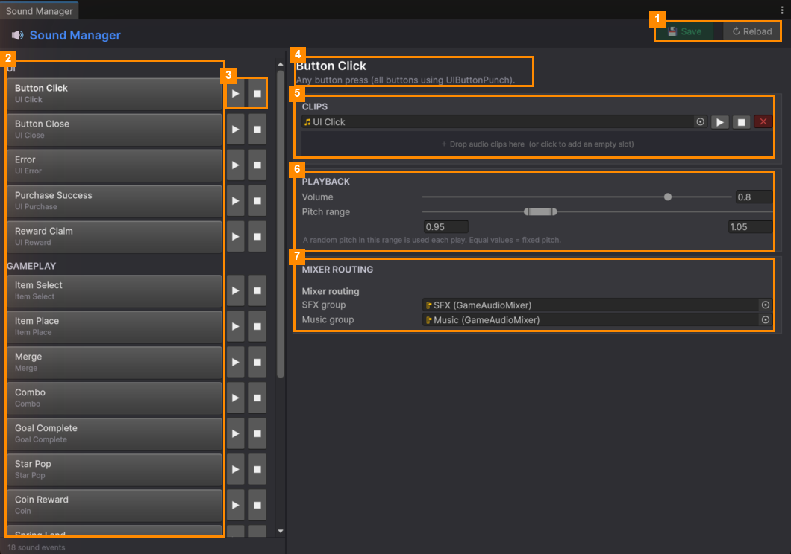
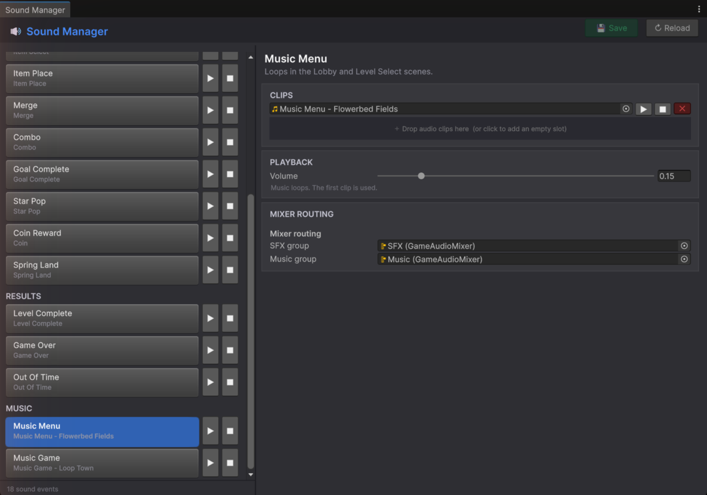

# Clips and Playback

### Clips

- **Add a sound:** drag audio files from the Project window onto the box that says
  **＋ Drop audio clips here**. Or click the box to add an empty slot, then drag a file into it.
- **Several clips:** one is picked at random each time the event plays. Great for footsteps, pops and taps.
- On each clip row: **▶** plays it, **■** stops it, and the red **✕** removes it from the list (the file itself is
  kept).

### Playback

| Setting | What it does |
|---|---|
| **Volume** | How loud this event is, from 0 (silent) to 1. Changes are heard straight away, even while the game runs. |
| **Pitch range** | Drag the two ends of the slider, or type the low and high numbers. Each time it plays, a random pitch in this range is used, so repeated sounds don't feel robotic. Equal numbers give a fixed pitch. |

### Music

The **MUSIC** events (*Music Menu* and *Music Game*) loop. Only the **first** clip is used, and there's no pitch
setting. Volume changes apply to the track while it's playing.

### Mixer Routing

**SFX group** and **Music group** send sounds to the game's audio mixer. The sound-effects and music volume
sliders in the in-game Settings panel control these groups. You normally don't need to change them.

> If the window says **No SoundLibrary found**, click **Create default Sound Library** to make a new one.

---
[↑ Sound Manager](README.md) · Next: [Power-up Manager →](../Power-up-Manager/README.md)
