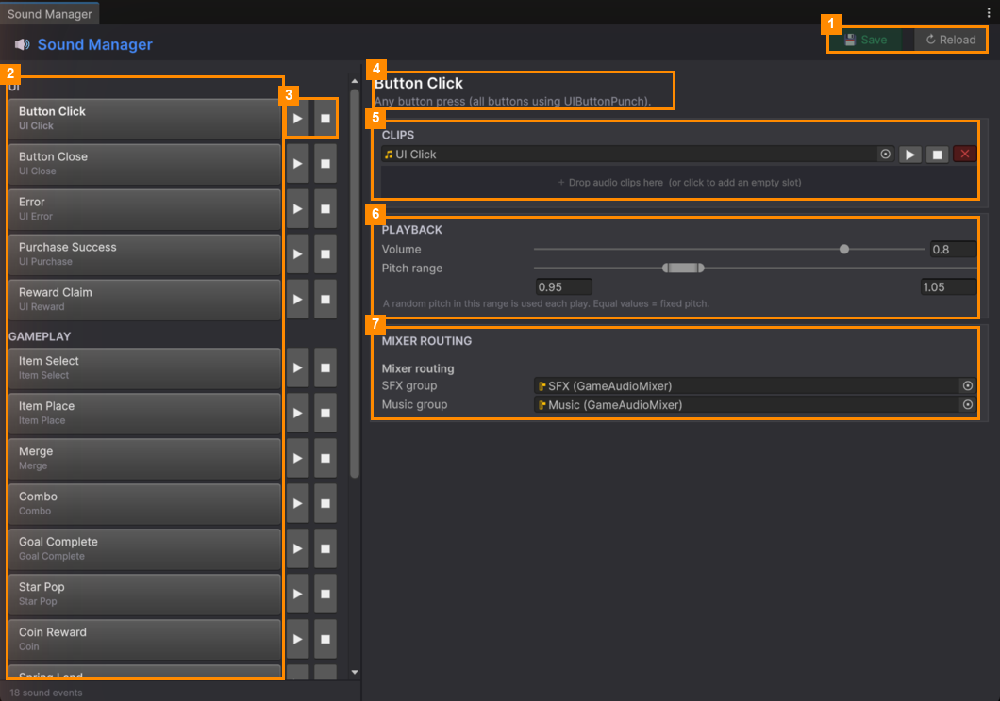

# Sound Manager

**Open it:** *Match Them All ▸ Sound Manager*. Every sound in the game is tied to an **event**, such as a
button click, an item landing in the tray, a merge, or a win. Pick an event and choose its sound.

| # | Part | What it does |
|---|---|---|
| 1 | **💾 Save** / **↻ Reload** | Save your changes, or throw them away. |
| 2 | **Event list** | Every event, grouped as UI, GAMEPLAY, RESULTS and MUSIC. Click one to edit it. |
| 3 | **▶** / **■** (in the list) | Play or stop the event's sound, without opening it. |
| 4 | **Event name and description** | What the event is and when it plays. |
| 5 | **Clips** | The sound files for the event ([Clips and Playback](Clips-and-Playback.md)). |
| 6 | **Playback** | Volume and pitch. |
| 7 | **Mixer Routing** | Which volume slider in the game's Settings controls the sounds. |

If an event has no sound file yet, the toolbar shows **⚠ … sound(s) without a clip**. Those events play silently.

## Pages

| Page | What it covers |
|---|---|
| [Clips and Playback](Clips-and-Playback.md) | Adding sound files, volume, pitch, music, and the mixer |

> **Power-up sounds** aren't here. Each power-up has its own sound in the
> [Power-up Manager](../Power-up-Manager/Edit-a-Power-up.md).

---
[↑ Editor Tools](../README.md) · Next: [Clips and Playback →](Clips-and-Playback.md)
