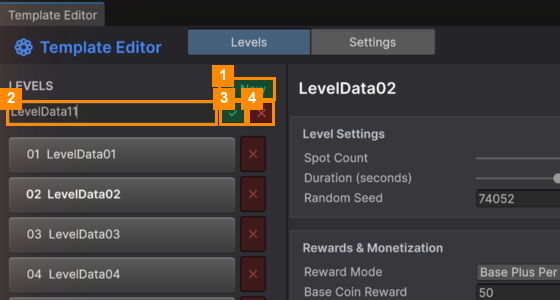
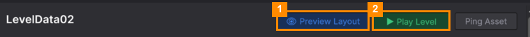

# Create and Test a Level

### Step 1: Make the level

1. Click **+ New** (1) at the top of the LEVELS list.
2. Type a name in the box that appears (2), for example `LevelData11`.
3. Click **✓** (3) to create the level, or **✕** (4) to cancel.

The new level goes to the end of the list and onto the level map. The map shows levels in name order, so to move a
level, rename its file.

### Step 2: Fill it in

Set the tray size, timer and rewards ([Level Settings and Rewards](Level-Settings-and-Rewards.md)), then add
items ([Items in a Level](Items-in-a-Level.md)). Once the level is playable, the summary bar shows
**✔ Valid level**. If it says **⚠ Needs at least 1 goal**, mark at least one item as a goal.

### Step 3: Preview and play

1. Click **👁 Preview Layout** (1). The pile of items appears in the Scene view, just as players will see it.
2. Don't like the layout? Change **Random Seed**, or click **🎲 Random**, then preview again.
3. Click **▶ Play Level** (2) to play only this level.

> If the Scene view is showing a different level from the one you're editing, you'll see a
> **⚠ Scene shows '…'** warning. Click **Preview Layout** again to update it.

### Step 4: Save

Click **💾 Save** in the top bar.

---
[↑ Template Editor](README.md) · Next: [Level Settings and Rewards →](Level-Settings-and-Rewards.md)
