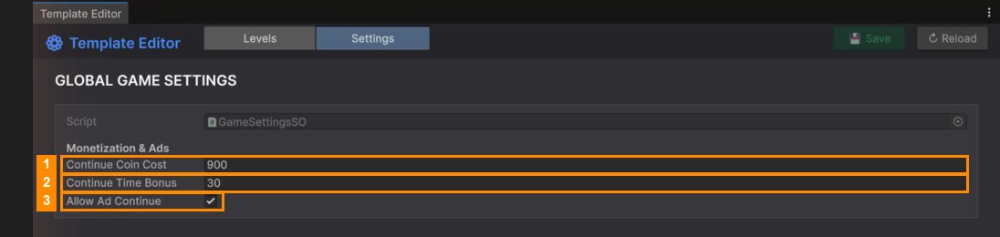

# Global Settings (Settings tab)

Click the **Settings** tab at the top of the Template Editor. These settings apply to **every level**.

| # | Field | What it does |
|---|---|---|
| 1 | **Continue Coin Cost** | Coins the player pays to keep playing when the timer runs out. |
| 2 | **Continue Time Bonus** | Seconds added when they continue. |
| 3 | **Allow Ad Continue** | Also offers "watch an ad to continue", for players without enough coins. |

These are stored in `Resources/GameSettings.asset`. You can also edit them there in the Inspector
([Continue Settings](../../04-Daily-Rewards-and-Settings/Continue-Settings.md)).

> If the tab shows **Create GameSettings Asset**, the settings file is missing. Click the button to make a new one
> with the default values.

---
[↑ Template Editor](README.md) · Next: [Item Manager →](../Item-Manager/README.md)
