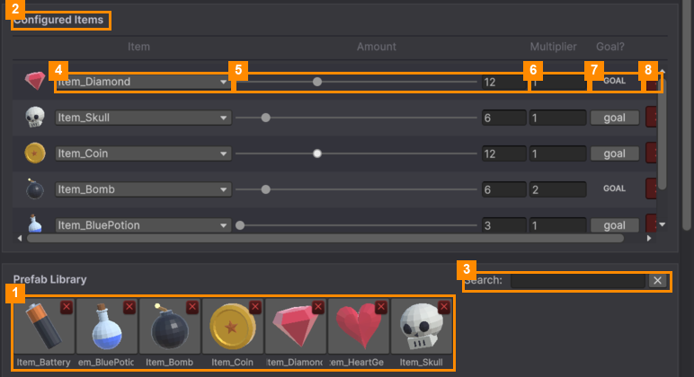

# Items in a Level

### Add an item

Click an item in the **Prefab Library** (1). It's added as a new row in **Configured Items** (2). Type in the
**Search** box (3) to find an item by name, and click the small **✕** next to the box to clear the search.

### Each row

| # | Column | What it does |
|---|---|---|
| 4 | **Item** | Which item this row is. Pick another from the drop-down to swap it. |
| 5 | **Amount** | How many the player must collect, from 3 to 30. **It must be a multiple of 3**, because items merge in threes. |
| 6 | **Multiplier** | How many copies go on the board: Amount × Multiplier. Use 2 or more to add **decoys**, so the right items are harder to find. |
| 7 | **Goal?** | **GOAL** (capitals): this item gets a goal card, and the player must collect it. **goal** (lower case): it's a filler. It's in the pile but not needed to win. Click to switch. |
| 8 | **✕** (red) | Removes the row from this level. The item itself isn't deleted. |

### The summary bar

Under the library, a bar shows the level at a glance: **Total Items**, **Goal Items**, **Goal Types** and
**Duration**, plus **✔ Valid level** or a warning such as **⚠ Needs at least 1 goal**.

> **Tip:** a level needs at least one goal row. Start with 2 or 3 goal items and a few filler rows.

---
[↑ Template Editor](README.md) · Next: [Tutorial Steps →](Tutorial-Steps.md)
