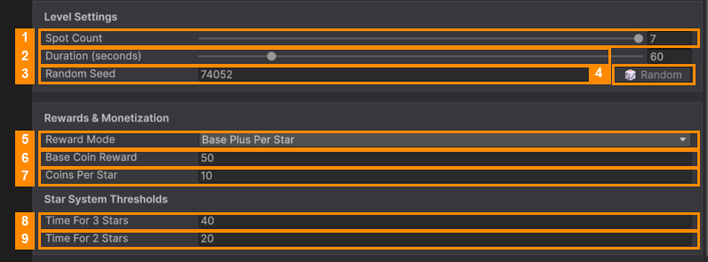

# Level Settings and Rewards

### Level Settings

| # | Field | What it does |
|---|---|---|
| 1 | **Spot Count** | How many slots the tray has, from 5 to 7. **Fewer slots make the level harder.** |
| 2 | **Duration (seconds)** | How long the timer runs, from 15 to 300 seconds. |
| 3 | **Random Seed** | Decides where the items fall. The same number always gives the same pile. |
| 4 | **🎲 Random** | Picks a new random seed, for a new layout. |

### Rewards & Monetization

| # | Field | What it does |
|---|---|---|
| 5 | **Reward Mode** | *Fixed Value*: the player always gets the **Base Coin Reward**. *Base Plus Per Star*: they get the base, plus **Coins Per Star** for each star. |
| 6 | **Base Coin Reward** | Coins for winning the level. |
| 7 | **Coins Per Star** | Extra coins for each star. Only used with *Base Plus Per Star*. |

### Star System Thresholds

| # | Field | What it does |
|---|---|---|
| 8 | **Time For 3 Stars** | Seconds that must be **left on the timer** for 3 stars. |
| 9 | **Time For 2 Stars** | Seconds that must be left for 2 stars. Any win gets at least 1 star. |

**Example:** Duration 60, 3 stars at 40, 2 stars at 20. Win with 45 seconds left: 3 stars. With 25 left:
2 stars. With 5 left: 1 star.

---
[↑ Template Editor](README.md) · Next: [Items in a Level →](Items-in-a-Level.md)
