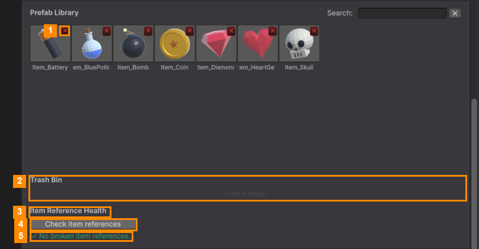

# Library, Trash and Health

These parts of the Template Editor manage the **items themselves**, not just one level.

### Prefab Library

| Action | What happens |
|---|---|
| **Click** an item | Adds it to the selected level ([Items in a Level](Items-in-a-Level.md)). |
| **Search** box | Shows only items whose name contains the text. |
| Small red **✕** on an item (1) | **Moves it to the Trash Bin**, after asking. It's also removed from every level that uses it, and the window tells you how many. |
| **Right-click** an item | *Move to Trash*, or **Delete Permanently…** (asks first, and can't be undone). |

To make new items, use the [Item Manager](../Item-Manager/README.md).

### Trash Bin (2)

Items you removed wait here, greyed out (the picture shows it empty). Click the green **⟲** on an item to
**restore** it. It goes back to the library and, where possible, back into the levels it was removed from.

### Item Reference Health (3)

If an item file is deleted outside the Template Editor, levels can be left pointing at nothing.

1. Click **Check item references** (4).
2. **✓ No broken item references** (5) means all is fine. Otherwise you get a list such as
   *LevelData03 → slot #2: missing item*.
3. Click **Remove all broken entries**, which appears under that list, to clean them up.

---
[↑ Template Editor](README.md) · Next: [Global Settings →](Global-Settings-Tab.md)
