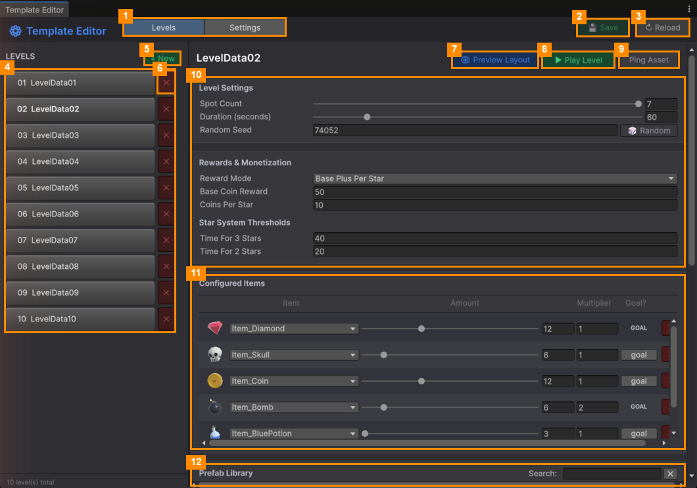

# Template Editor

**Open it:** *Match Them All ▸ Template Editor*. This is where you make and change levels.

| # | Part | What it does |
|---|---|---|
| 1 | **Levels / Settings tabs** | *Levels* edits levels. *Settings* edits the global game settings ([Global Settings](Global-Settings-Tab.md)). |
| 2 | **💾 Save** | Saves your changes. Turns green when something is unsaved. |
| 3 | **↻ Reload** | Throws away unsaved changes and reloads everything. |
| 4 | **LEVELS list** | All levels, in the order players meet them. Click one to edit it. |
| 5 | **+ New** | Makes a new level ([Create and Test a Level](Create-and-Test-a-Level.md)). |
| 6 | **✕** (next to a level) | Deletes that level, after asking. This can't be undone. |
| 7 | **👁 Preview Layout** | Shows the selected level's pile of items in the Scene view. |
| 8 | **▶ Play Level** | Plays only the selected level. |
| 9 | **Ping Asset** | Highlights the level's file in the Project window. |
| 10 | **Level Settings, Rewards** | Tray size, timer, layout and rewards ([Level Settings and Rewards](Level-Settings-and-Rewards.md)). |
| 11 | **Configured Items** | Which items are in the level, and which are goals ([Items in a Level](Items-in-a-Level.md)). |
| 12 | **Prefab Library** | Every item you can add. Click one to add it to the level. |

Further down the window you'll also find the **Trash Bin** and **Item Reference Health**
([Library, Trash and Health](Library-Trash-and-Health.md)), a summary bar, and **Tutorial Steps**
([Tutorial Steps](Tutorial-Steps.md)).

## Pages

| Page | What it covers |
|---|---|
| [Create and Test a Level](Create-and-Test-a-Level.md) | Making a new level, previewing it, playing it and saving it |
| [Level Settings and Rewards](Level-Settings-and-Rewards.md) | Tray size, timer, layout, coins and stars |
| [Items in a Level](Items-in-a-Level.md) | Adding items, amounts, decoys and goals |
| [Tutorial Steps](Tutorial-Steps.md) | Guided steps that point the player at something |
| [Library, Trash and Health](Library-Trash-and-Health.md) | Searching items, removing and restoring them, fixing broken references |
| [Global Settings](Global-Settings-Tab.md) | The Settings tab |

---
[↑ Editor Tools](../README.md) · Next: [Create and Test a Level →](Create-and-Test-a-Level.md)
