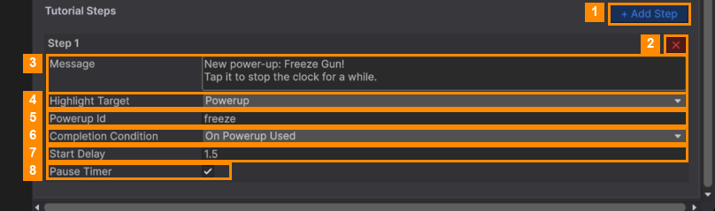

# Tutorial Steps

A tutorial step darkens the screen, highlights one thing, shows a message, and waits for the player to do it.
Level 1 teaches matching. Levels 2 to 5 each introduce a new power-up.

### Add or remove a step

- **+ Add Step** (1) adds a step to the end. Steps run in order, one after another, when the level starts.
- **✕** (2) at the top right of a step removes it.

### Step fields

| # | Field | What it does |
|---|---|---|
| 3 | **Message** | The text shown to the player. Keep it short. |
| 4 | **Highlight Target** | What to point at. See the table below. |
| 5 | **Powerup Id** | For *Powerup*: the power-up's id, for example `freeze`, `fan`, `spring` or `vacuum` (shown in the [Power-up Manager](../Power-up-Manager/README.md)). |
| 6 | **Completion Condition** | What ends the step. See the table below. |
| 7 | **Start Delay** | Seconds to wait before the step appears, so items can settle first. |
| 8 | **Pause Timer** | Stops the level timer while the step is showing. |

A step only shows the fields its choices need. These appear instead of, or as well as, **Powerup Id**:

| Field | Shown for | What it does |
|---|---|---|
| **Item Name** | *Specific Item*, *Goal Card* | Which item. |
| **Manual Targets** | *Manual* | Drag objects from the scene in. **+ Add Target** adds a slot, and **✕** removes one. |
| **Auto Complete Delay** | *On Timer* | Seconds before the step ends by itself. |

### Highlight Target options

| Option | Highlights |
|---|---|
| **Auto Find Items** | Any 3 matching items in the pile. The player can only tap those. |
| **Specific Item** | 3 items of the type in **Item Name**. The player can only tap those. |
| **Powerup** | The power-up button with the id in **Powerup Id**. |
| **Goal Card** | The goal card of the item in **Item Name**. |
| **Manual** | Whatever you put in **Manual Targets**. |

### Completion Condition options

| Option | The step ends when… |
|---|---|
| **On Merge** | The highlighted items merge. Use it with *Auto Find Items* or *Specific Item*. |
| **On Powerup Used** | The highlighted power-up **actually runs**. A tap that does nothing, or one that opens the "buy a charge" popup, doesn't count. |
| **On Timer** | **Auto Complete Delay** seconds have passed. Good for "look at this" messages. |
| **Manual** | Your own code says so. For programmers: `TutorialManager.Instance.CompleteCurrentStep()`. |

> **Power-up steps wait until the power-up can be used.** For example, the Spring needs an item in the tray,
> so its step appears as soon as the player has put one there.

> Tutorial steps play **every time** the level is played, not only the first time.

---
[↑ Template Editor](README.md) · Next: [Library, Trash and Health →](Library-Trash-and-Health.md)
