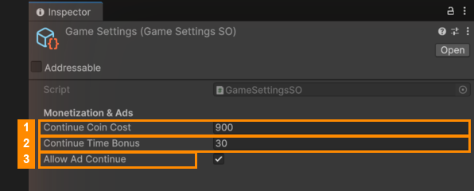

# Continue Settings

When the timer runs out, the player can **continue**: pay coins, or watch an ad, for extra seconds.

Edit these in the Template Editor's **Settings** tab, or select `Resources/GameSettings` in the Project window and
use the Inspector.

| # | Field | Default | What it does |
|---|---|---|---|
| 1 | **Continue Coin Cost** | 900 | Coins the player pays to continue. |
| 2 | **Continue Time Bonus** | 30 | Seconds added to the timer. |
| 3 | **Allow Ad Continue** | on | Also offers "watch an ad to continue", for players without enough coins. |

---
[↑ Daily Rewards and Settings](README.md) · Next: [Ads and In-App Purchases →](../05-Ads-and-In-App-Purchases/README.md)
