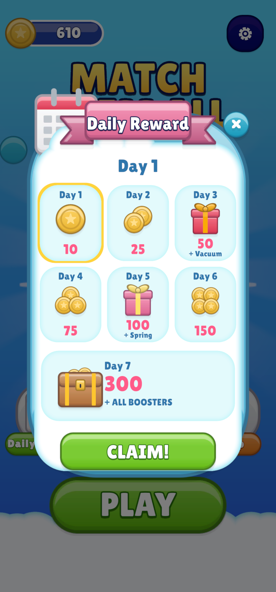

# Daily Rewards

Players get a reward for each day they open the game, for **7 days in a row**. Missing a day starts the streak
again at day 1.

- The reward panel opens by itself once a day, from the Lobby.
- The **Daily Rewards** button in the Lobby opens it again. After today's reward is claimed, the Claim button
  is greyed out until tomorrow.

### Changing the rewards

The rewards are set in two places, which **must match**:

1. **What the player gets**: `Scripts/Runtime/Core/DailyRewardManager.cs`, in `GrantReward`. There's one
   `case` for each day.
2. **What the panel shows**: the labels in the `DailyRewardPanel` prefab.

Changing the first means editing a script. If you're not comfortable with that, ask a programmer, or keep the
default rewards.

 

---
[↑ Daily Rewards and Settings](README.md) · Next: [Continue Settings →](Continue-Settings.md)
