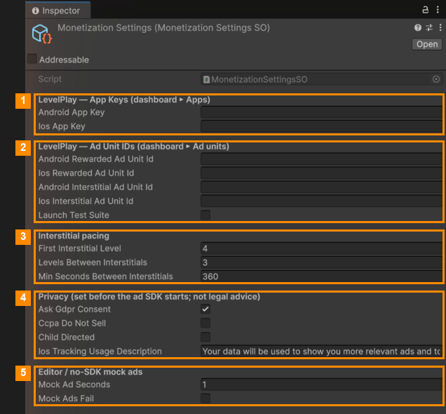

# Ads

All ad settings are in one file: select `Resources/Monetization/MonetizationSettings` in the Project window and
use the Inspector.

### Where ads appear

| Ad | When |
|---|---|
| **Rewarded** (the player chooses to watch) | Continue when out of time · a free charge for a power-up at 0 · free coins in the shop |
| **Interstitial** (shown between levels) | After *Next* or *Retry*, limited by the pacing settings below |

### Settings

| # | Section | Fields |
|---|---|---|
| 1 | **LevelPlay: App Keys** | **Android App Key**, **iOS App Key**: copy them from the LevelPlay dashboard (*Apps*). |
| 2 | **LevelPlay: Ad Unit IDs** | The **Rewarded** and **Interstitial** ad unit ids for Android and iOS, from the dashboard (*Ad units*). **Launch Test Suite** opens LevelPlay's test screen in development builds. |
| 3 | **Interstitial pacing** | **First Interstitial Level**: no in-between ads before this level. **Levels Between Interstitials**: at most one every N levels. **Min Seconds Between Interstitials**: and never more often than this. |
| 4 | **Privacy** | **Ask Gdpr Consent**: asks European players for consent on first launch. **Ccpa Do Not Sell**: the California "do not sell" setting. **Child Directed**: the game is for children under 13 (COPPA). **Ios Tracking Usage Description**: the text of the iOS tracking question. |
| 5 | **Pretend ads (Editor / no SDK)** | **Mock Ad Seconds**: how long the fake video lasts. **Mock Ads Fail**: makes every ad fail, to test what players see when no ad is available. |

### Testing

- In the Editor (and on PC/Mac), the pretend ads are always used, even with LevelPlay installed. Real ads only
  run in an **Android or iOS** build.
- A player who buys **Remove Ads** in the shop doesn't see in-between ads
  ([Products](../03-Editor-Tools/Shop-Manager/Products.md)).

---
[↑ Ads and In-App Purchases](README.md) · Next: [In-App Purchases →](In-App-Purchases.md)
