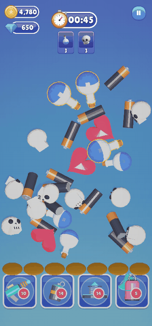
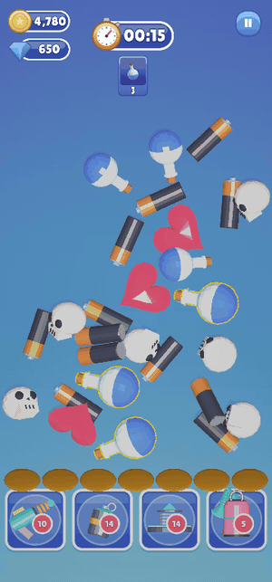
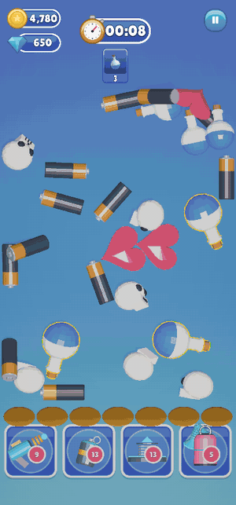

# Match Them All: User Guide

Welcome! This guide shows you how to run the template, make your own levels and items, and set up the shop,
sounds, power-ups, ads and in-app purchases. **You don't need to write code** for any of it: everything is done
with buttons and fields in the Unity Editor.

  
  
  

## Contents

| | Section | What you'll find |
|---|---|---|
| 1 | [Getting Started](01-Getting-Started/README.md) | What to install, and how to press Play for the first time |
| 2 | [How the Game Plays](02-How-The-Game-Plays/README.md) | Short clips of matching, power-ups, winning and losing |
| 3 | [Editor Tools](03-Editor-Tools/README.md) | Every window in the **Match Them All** menu, button by button |
| 4 | [Daily Rewards and Settings](04-Daily-Rewards-and-Settings/README.md) | The 7-day reward, and the "continue" price and time |
| 5 | [Ads and In-App Purchases](05-Ads-and-In-App-Purchases/README.md) | Turning on real ads and real-money products |
| 6 | [Build for Android and iOS](06-Build-for-Android-and-iOS/README.md) | Making a build for a phone |
| 7 | [Troubleshooting](07-Troubleshooting/README.md) | Common problems and how to fix them |

## How to read this guide

- **Numbers in pictures.** Screenshots have numbered boxes. The numbered list under each picture explains
  what that part does.
- **Menu paths** are written like **Match Them All ▸ Template Editor**: click *Match Them All* in the menu bar
  at the top of Unity, then *Template Editor*.
- **Save your work.** Most windows have a **💾 Save** button. It turns green when you have unsaved changes.

> For programmers: `ARCHITECTURE_OVERVIEW.md` and `API_REFERENCE.md` (one folder up) explain the code.
